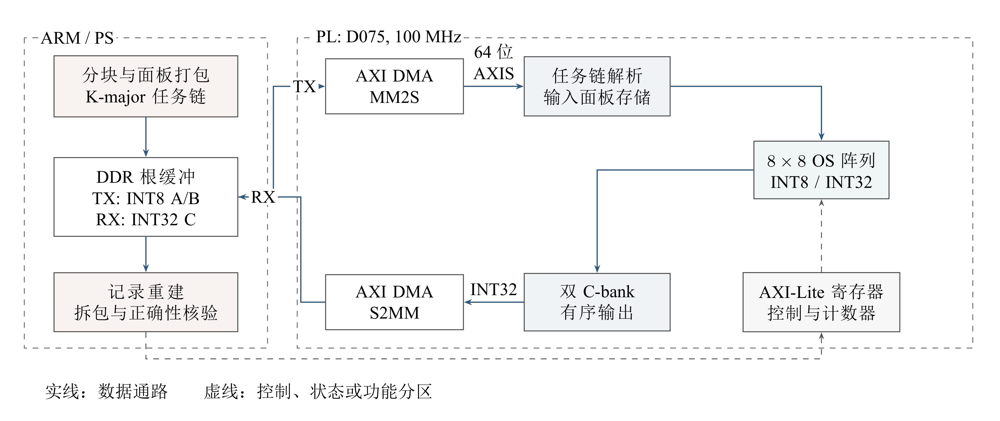
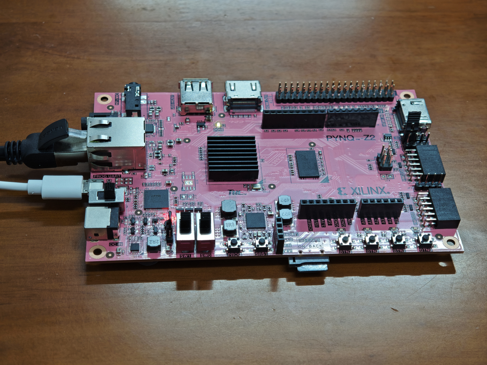

<div align="center">

# 可重构脉动阵列矩阵加速器

**OpenNPU-Lite · 可编程 INT8 计算 · PYNQ-Z2 / Zynq-7020**

Hextech · 团队编号 41971 · 初级组自主选题

[设计报告](report/design_report.pdf) · [下载工程](https://github.com/cpfbx/OpenNPU-Lite-FPGA/releases/tag/submission-public-20261104) · [开始复现](reproduction_guide.md) · [验证 Skill](skill/README.md)

</div>

OpenNPU-Lite 在小型 FPGA 上构建尺寸可配置的整数矩阵计算平台。8×8 输出驻留脉动阵列完成 INT8 乘法和 INT32 累加，ARM 负责分块、任务组织与应用后处理。通过 K-major 供数、输入预取和双 C-bank 调度，平台在同一比特流上承接通用矩阵任务与关键词识别中的 Pointwise 计算。

<p align="center">
  
</p>

## 先看什么

| 你的目的 | 建议入口 |
|---|---|
| 快速了解作品 | 阅读本页的能力、实测结果与实物图 |
| 评审设计与创新 | [详细设计报告](report/design_report.pdf)：背景、原理、接口、优化及判断依据 |
| 没有开发板，先运行验证 | [下载与 PC 复现](reproduction_guide.md#2-准备-pc-环境并核对文件) |
| 查看流水和接口行为 | [Vivado 原生仿真与波形](sim/results/native_20261030/readme.md) |
| 重建硬件或复做实板实验 | [完整硬件构建](reproduction_guide.md#6-完整硬件构建)、[板端操作指南](board/quickstart.md) |

## 平台能力与实现要点

- **运行时可编程。** 主机配置 M、N、K，以 64×64 逻辑分块组织任务，支持 K 维归约和尾块填充。改变矩阵几何与已支持任务不需要重新生成比特流。
- **计算与数据流协同。** 8×8 物理阵列采用 K-major 输入布局，预取下一组数据；双 C-bank 为计算写入与结果排出提供独立存储。
- **软硬件分工明确。** PL 执行规则矩阵乘加；ARM 组织 DMA 任务链，并完成 KWS 所需的零点校正、偏置、逐通道定点重定量化和激活。
- **执行过程可检查。** 硬件计数器记录工作量及周期，独立整数参考核对数值，传输帧逆解码检查实际送入的操作数。

目标器件为 **xc7z020clg400-1**，完整实现工作于 **100 MHz**，使用 **26,762 LUT、27,575 FF、11 BRAM Tile、72 DSP**，setup 与 hold 时序收敛。完整数据见[资源及时序报告](build/readme.md)。

## 从原理到应用的研发成果

平台沿着**可编程阵列 → 硬件供数与重叠 → 主机完整请求 → KWS动态接线 → 工程复现**推进。下面各行对应独立实验，展示每一步解决的成本；它们不是可以连乘的加速序列。

| 阶段 | 做了什么 | 对应结果与证据 |
|---|---|---|
| 可编程计算基础 | 8×8物理阵列、64×64逻辑分块、K维归约及运行时尺寸配置 | D075完整实现100 MHz，setup/hold收敛；[原理与原生波形](sim/results/native_20261030/readme.md) |
| K-major供数 | 按阵列消费顺序组织输入 | 同BIT MODE3→MODE5，512³ DMA+PL **106.687→63.972 ms**；接收计数降至约1/9。[E02](report/evidence/e02.md) |
| 首K覆写、输入预取 | 去掉独立清零；在计算期间准备下一面板 | 512³配对总周期分别减少 **262,144**、**459,200 cycles**。[E03](report/evidence/e03.md)、[E04](report/evidence/e04.md) |
| 双C-bank与MODE11 | 计算和另一银行结果排出重叠 | 同BIT MODE10→MODE11，512³ DMA+PL **36.221→31.262 ms**；纯PL有效吞吐 **4.467 GMAC/s**。[E05](report/evidence/e05.md) |
| 请求内面板与布局复用 | 降低主机重复构造成本 | 512³完整请求 **714.535→284.216 ms，减少60.22%**；DMA+PL基本不变。[E06](report/evidence/e06.md) |
| flat与连续面板 | 继续优化任务及字节组织 | 10/21、10/22两场512³请求分别减少 **10.76%、9.54%**；后者256³减少 **10.32%**。[同场数据](report/figure_data/complete_request.csv) |
| 动态KWS应用链 | CPU420、单层映射、共享中段及完整PC图逐级接通 | **真实共享12窗：24次Pointwise请求、48 jobs、12次ARM DW3，768,000检查点零差异**；完整WAV到分类结果另有PC动态验证。[应用结果](report/development_results.md#3-从单算子到动态kws链路) |
| 工程复现与取舍 | 完整构建、异机核验、原生波形、故障反例与验证Skill | 10/31连续拍摄重现矩阵改善并顺序完成共享链；原生候选退化、CPU对照与旧版本长稳分别保留。[全链条结果](report/development_results.md) |

### 怎样理解最终表现

- **计算核：** 512³纯PL为4.467 GMAC/s；DMA+PL约31 ms。它们与包含主机构帧、校验和重建的完整请求分别计时。
- **完整请求：** 10/22候选在256³/512³分别为52.672/241.510 ms，同场双线程OpenBLAS为25.342/171.555 ms。10/31独立复现得到51.742/238.188 ms，方向与量级一致，原场次数据保留。
- **应用覆盖：** ARM CPU420完成前处理及完整CPU参考；真实ARM/PL共享会话覆盖Op2→CPU depthwise3→Op4；完整KWS图从公共WAV到分类结果在PC硬件夹具中验证。完整混合模型实板部署和实时音频仍是后续工作。
- **能量取舍：** 单组ABBA完整保存包络约低1.4%，同时记录请求延迟与处理器时间，详见设计报告第5章。

[按阶段查看机制、全部对照与来源](report/development_results.md) · [详细设计报告](report/design_report.pdf) · [证据导航](report/evidence/readme.md)

<p align="center">
  
</p>

实物、原生波形、工具报告和返回数据均可从本仓库继续追溯。已有结果的查看与 PC 复现均无需连接开发板。

## 下载后先运行什么

1. 从[正式下载页](https://github.com/cpfbx/OpenNPU-Lite-FPGA/releases/tag/submission-public-20261104)下载 `opennpu_lite_41971_source.zip`，解压到短路径。
2. 按[环境准备](reproduction_guide.md#2-准备-pc-环境并核对文件)安装 Python 3.12+ 和 NumPy 2.3.5，环境及输出目录放在工程外。
3. 在解压后的工程根目录打开 PowerShell，运行下面的文件核验。命令从正式下载页获取校验值，无需寻找本地“外部文件”或替换哈希占位符。

```powershell
$ErrorActionPreference = 'Stop'
$releaseBase = 'https://github.com/cpfbx/OpenNPU-Lite-FPGA/releases/download/submission-public-20261104'
$checksums = Invoke-RestMethod "$releaseBase/checksums.txt"
$manifestMatches = [regex]::Matches($checksums, '(?m)^([0-9a-f]{64})  manifest\.json\r?$')
if ($manifestMatches.Count -ne 1) { throw '发布校验文件不完整，请重新下载。' }
$manifestSha = $manifestMatches[0].Groups[1].Value
python -I -B .\reproduce.py --manifest-sha $manifestSha
if ($LASTEXITCODE -ne 0) { throw '工程文件核验失败，请检查下载件。' }
```

正常输出包含 `operation_success=true`；默认入口只检查文件。随后可选择：

| 入口 | 做什么 | 需要开发板 |
|---|---|---|
| `check`，默认 | 核对工程清单和全部文件 | 否 |
| `pc` | 共享链算术、Skill 与补充清理核验 | 否 |
| `hybrid-smoke` | 从 WAV 运行一窗完整 KWS 离线计算图 | 否 |
| `hybrid12` | 运行固定12窗完整 KWS 离线计算图 | 否 |

PC 入口需要显式 `--enable-offline`，结果写入工程外的新目录。[完整命令、成功输出和错误排查](reproduction_guide.md)在复现指南中逐项说明。使用 Git 获取时，关闭自动换行转换，并导出不含 `.git` 元数据的工程目录后再核验，详见指南第1节。

## 从原理到应用

[8×8 阵列与分块](report/figures/fig02_array_tiling.png) → [预取及双 C-bank](report/figures/fig03_storage_schedule.png) → [PS/PL 软件调用](report/figures/fig10_software_functions.png) → [KWS 完整图与实板中段](report/figures/fig08_kws_graph.png)。

团队提出实现要求、审查结果并决定修订范围。选取的提示词、模型答复和实现纠错按实际先后记录在[人机协作案例](report/collaboration_interactions.md)；[三个验证 Skill](skill/README.md)给出各自适用场景、使用方法、失败条件和复用记录。

## 工程目录

| 目录 | 内容 | 用途 |
|---|---|---|
| [src/](src) | RTL、PS运行时、验证器及硬件重建包装 | 设计源码 |
| [sim/](sim) | 仿真源码、脚本、原始日志及波形 | 仿真或验证结果 |
| [build/](build) | 完整实现及干净重建报告；构建入口见 `src/hardware/` | 构建与资源/时序报告 |
| [board/](board) | BIT/HWH、运行包、现场命令模板及实板原件 | 上板工程与实测输出 |
| [data/](data) | 模型、公共输入及冻结参考包 | 测试数据与参考结果 |
| [skill/](skill/README.md) | 三个可复用验证 Skill 及提炼记录 | 技能包 |
| [report/](report) | 一份详细设计报告（PDF/Markdown）、图表、技术交互与证据索引 | 设计报告与大模型协作记录 |
| [provenance/](provenance) | 第三方许可、来源及命名适配记录 | 补充来源说明 |

设计原理、软硬件接口、优化实验、协作案例及复现方法见[报告导航](report/readme.md)。`README.md`、`SKILL.md`保留标准入口名称，其余实际文件名使用小写。自有许可见[license](license)，第三方资产按[许可与来源表](provenance/third_party_notices.md)使用。
