# 可重构脉动阵列矩阵加速器 设计报告

OpenNPU-Lite · Hextech · 团队编号41971

# 摘要

针对小型SoC中计算阵列、数据搬运与主机调用难以协同优化的问题，本项目设计并实现OpenNPU-Lite流式矩阵加速平台。系统基于PYNQ-Z2，以8×8输出驻留脉动阵列完成INT8乘法和INT32累加，通过K-major供数、首K块覆写、预取与双结果银行组织计算数据流。ARM负责运行时任务切分、连续缓冲和应用算术，使同一比特流能够承接不同几何的矩阵任务及量化Pointwise算子。

项目按供数、执行重叠和主机组织逐层优化。K-major同BIT对照将512³ DMA+PL由106.687 ms降至63.972 ms；首K覆写和预取分别减少262,144及459,200个周期，双C-bank的MODE11进一步将同BIT DMA+PL由36.221 ms降至31.262 ms。D075在100 MHz下完整实现收敛，使用26,762 LUT、27,575 FF、11个BRAM Tile和72个DSP。请求内面板与布局复用将另一场512³完整请求由714.535 ms降至284.216 ms，减少60.22%；后续flat和连续面板在各自同场512³对照中再获10.76%和9.54%改善。项目以同场CPU对照、阶段分解和原件复算说明每项收益的来源。

在应用层，平台完成固定12窗PL Op2→ARM depthwise3→PL Op4的真实共享资源执行，768,000个标量检查点零差异；ARM CPU420建立了端侧前处理和完整整数参考，完整WAV到分类建议另在PC离线图中完成动态接线。项目进一步将布局、计时和接口检查经验整理为验证Skill，形成从可重建硬件、请求级优化到应用接线的完整工程主线。平台实现、同场性能对照及可执行复现入口共同支撑其设计价值。

**关键词：** INT8矩阵乘法；脉动阵列；流式任务；PS/PL协同；关键词识别；工程复现。

# 1 选题背景、相关工作与项目贡献

## 1.1 为什么选择矩阵计算平台

矩阵乘加连接着通用数值计算和神经网络推理。全连接层可以直接表示为矩阵乘法，1×1卷积则可将空间位置展开为矩阵行，在通道维完成点积。因此，一个尺寸可配置的整数矩阵平台能够服务多种任务，也便于用独立数学参考检查计算是否精确。

小型SoC上的加速效果取决于数据怎样进入计算核。处理器需要切分矩阵、构造连续字节、维护DMA缓冲并重建结果。片上阵列还需要完成装载、归约和输出。增加乘法器只能改变其中一部分成本。本项目选择PYNQ-Z2，在有限资源下同时研究阵列供数、流式调度和主机运行时，使每次优化都能回答“减少了哪一段成本、完整请求是否受益”。

关键词识别提供了检验这一平台的实际应用。音频前处理生成低精度特征，Pointwise层形成小矩阵乘法，量化零点、逐通道尺度与非满块尾部又要求接口保持精确。围绕这些问题组织应用验证，可以检查矩阵平台是否真正具备进入模型计算图的能力。

## 1.2 前人工作与设计取舍

已有加速器研究表明，数据复用和系统集成与阵列算力同样重要。Gemmini以全栈加速器生成器连接硬件、软件及SoC资源，强调操作系统和编程栈对最终性能的影响[R1]。Eyeriss通过空间PE阵列、可重配置多播与数据复用降低数据移动成本[R2]。NVDLA将可配置计算模块、卷积缓冲和管理处理器组织为完整推理架构，并以融合通路减少模块之间的内存往返[R3]。

这些工作分别从数据复用、软件栈与模块间搬运说明了系统组织的重要性。OpenNPU-Lite围绕Zynq ARM与AXI Simple DMA构建较小的实现，将运行时尺寸、链式分块和可读计数器作为主要接口，再通过真实调用定位当前的系统成本。

表1  相关工作与本项目设计选择

| 参照工作 | 与本项目相关的设计思想 | OpenNPU-Lite的具体选择 |
| --- | --- | --- |
| Gemmini | 阵列、存储与软件栈共同决定系统表现 | 在ARM/AXI DMA环境中同时测量PL、DMA+PL和完整请求 |
| Eyeriss | 空间计算与数据复用相结合 | 采用输出驻留阵列与K-major供数，定量分析当前跨job面板重传 |
| NVDLA | 处理器配置可组合计算模块，以缓冲和融合通路降低搬运 | 以矩阵核承担Pointwise，ARM保留前后处理和逐通道量化，先建立精确跨层接口 |

本表比较设计方向与接口选择。文献中的ASIC性能和能效采用各自平台与负载，本文的定量评价使用本项目同场实测。

## 1.3 以系统成本驱动的设计贡献

**将优化决策从阵列窗口推进到完整请求。** 团队先按供数、清零、预取和结果排出逐项改进硬件，再以完整请求定位主机瓶颈。请求内面板与布局复用使512³完整请求从714.535 ms降至284.216 ms；后续flat与连续面板分别获得10.76%和9.54%的同场改善。引入优化CPU基线后，完整请求仍需进一步缩短；原生候选47.07%的退化也被保留并用于取舍。硬件计数、外层计时与强CPU对照共同构成这条协同优化方法。[E02–E11]

**以存储所有权实现可观察的数据流重叠。** K-major、首K块覆写和预取减少接收、清零与等待成本，双C-bank在不同银行间协调计算与输出。全局工作计数把并行事件闭合到总周期，硬件机制可以由对应版本和实测检验。该实现将流式调度落实在同一套可重建的矩阵硬件中。[E02–E05]

**用动态跨层数据流验证矩阵接口的应用价值。** 平台在一个真实资源会话内交替执行两层Pointwise，由ARM完成中间depthwise和逐通道量化，连接实际返回张量。完整PC离线图进一步贯通音频前处理及模型前后缀，说明矩阵服务可以沿精确量化接口扩展到模型计算图。[E21、E30–E34]

**将工程判断沉淀为可复用工具。** 团队把元数据误判、布局差异和嵌套计时等实际问题转化为Skill规则与正反例。算法、实现、实测输出和脚本均有来源对应，使成果既能展示，也能由接收者逐层核查。[E17、E27、E29]

## 1.4 作品概览

表2  项目成果与报告入口

| 评审关注点 | 已完成成果 | 本文入口 |
| --- | --- | --- |
| 能做什么 | 运行时尺寸/链任务配置，INT8输入、INT32累加，同一硬件承接矩阵和Pointwise | 第2–3章 |
| 如何优化 | 供数、累加初值、预取、结果重叠与主机面板组织协同改进 | 第3–4章 |
| 实际效果 | 从K-major、预取和重叠到请求复用；512³请求复用实验减少60.22%，后续两场各减少10.76%和9.54% | 第4章 |
| 应用验证 | ARM CPU420、真实共享12窗中段及完整图PC离线动态接线 | 第6章 |
| 如何复核 | 工具报告、原运行包、实测原件及参考比对，加上统一PC入口 | 第8章及完整工程 |

本文的“可重构”对应FPGA实现及编译期阵列参数配置，矩阵尺寸和任务链在运行时配置。系统级实板主链路采用输出驻留（OS）；PE级权重驻留探索另列。大矩阵接口M、N、K各覆盖已定义的1至512范围，输出块与K块上限为64，应用入口可采用更窄策略。

### 实物平台与连接

实物平台由主机、PYNQ-Z2开发板与USB测试仪组成。以太网承担板端通信，单路USB路径提供供电；俯视和斜视照片展示主要接口、散热器及指示灯。

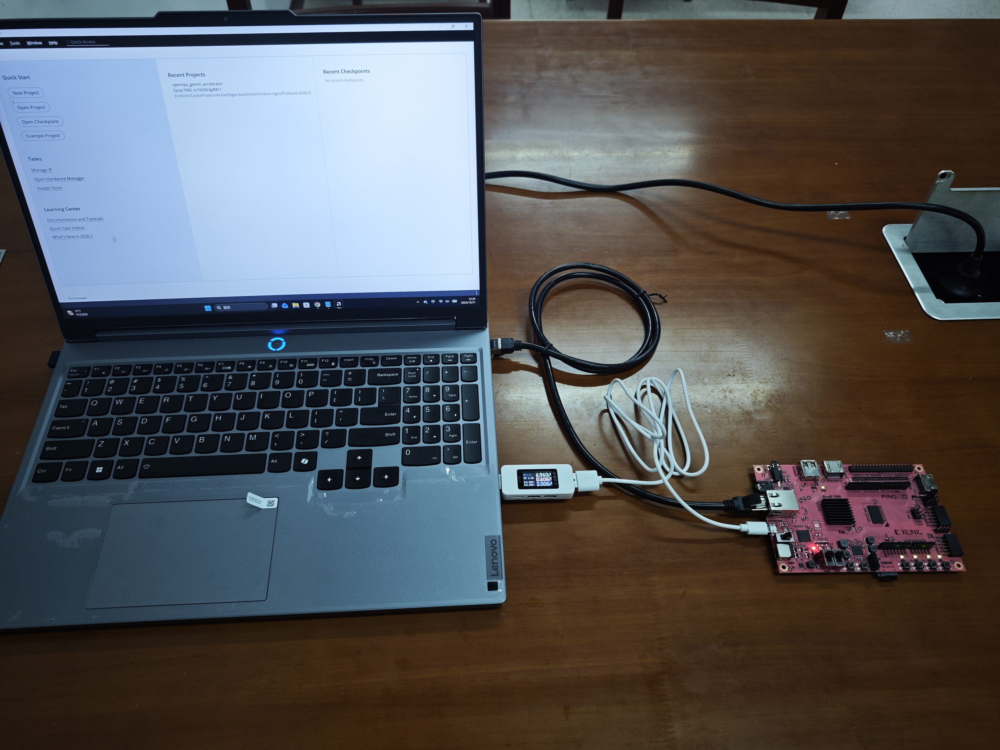

实物图1　系统全貌。主机经以太网连接PYNQ-Z2，USB供电路径串接UT70测试仪。

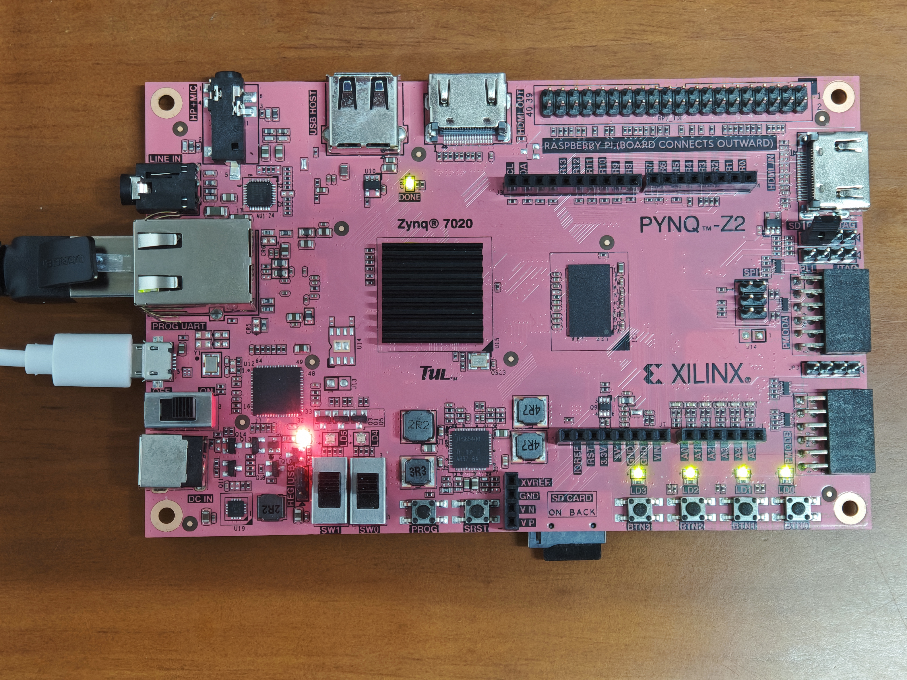

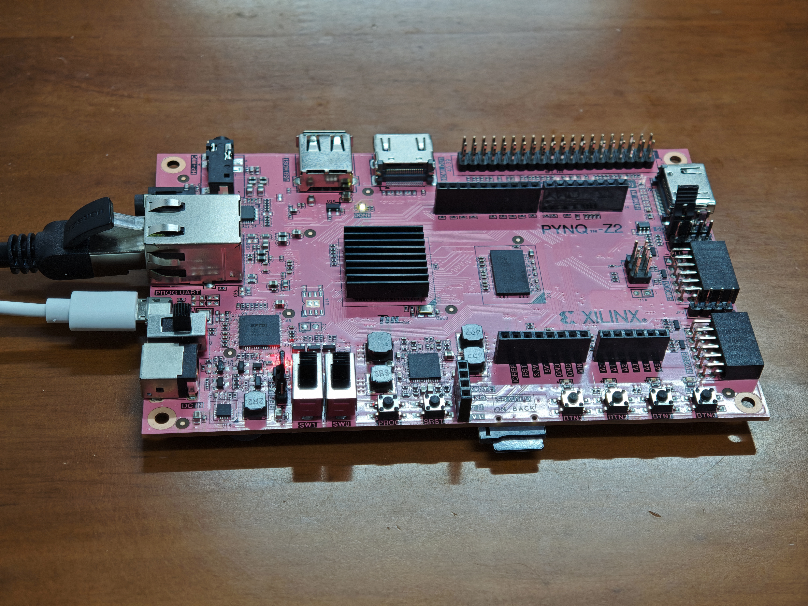

实物图2　开发板实物。（a）俯视；（b）斜视。网口与Micro-USB接口位于板卡左侧，独立DC输入未连接。

# 2 总体架构与软硬件划分

## 2.1 数据通路与控制通路

系统由ARM请求处理、DDR连续缓冲、AXI DMA和PL矩阵核组成。图1用实线表示数据，虚线表示控制与状态。主机将任务链写入发送根缓冲，MM2S将其送入PL；计算结果经S2MM回到接收根缓冲，再由主机重建矩阵或应用张量。

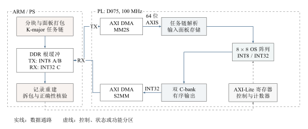

图1  D075的请求通路由ARM、DDR根缓冲、AXI DMA、共享阵列和双C-bank构成。实线表示数据流，虚线表示控制、状态或功能边界；PL工作时钟为100 MHz。

PL主链路接收64-bit AXI Stream，传输在TVALID与TREADY同时有效时完成。AXI-Lite用于配置、启动、复位和读取能力及状态，形成独立控制通路。主实验采用PS FCLK0的100 MHz时钟。早期UART顶层为另一入口。[E01、E24]

概念框图说明模块职责，实际集成则由图2展开。控制访问和批量数据搬运使用不同通路：PS经GP0配置DMA与加速器；MM2S将DDR中的请求送入加速器，S2MM把结果写回DDR，两条存储器主通路经SmartConnect接入HP0。时钟、复位与中断同样在Block Design中明确连接。这使驱动的寄存器操作、DMA长度与真实硬件接口能够一一对应。[E01、E41]

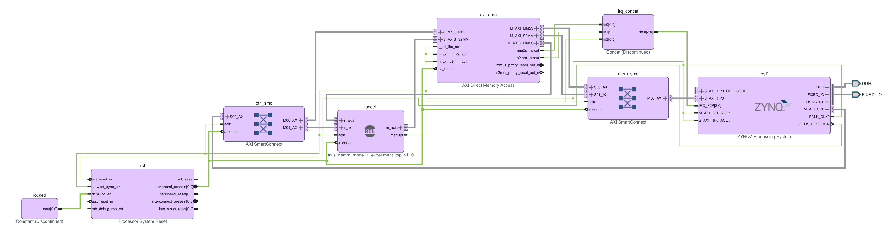

图2　Vivado原生Block Design。PS通过GP0和ctrl_smc访问DMA及加速器控制寄存器；DMA的MM2S/S2MM流接口连接加速器，存储器主接口经mem_smc访问PS的HP0。FCLK及Processor System Reset提供时钟/复位，中断经irq_concat汇入PS。原生SVG/PDF随本版保留。[E01、E41]

## 2.2 划分依据

PL适合承担规则、密集且可以展开并行的矩阵点积。将乘法和累加固定为流水结构后，阵列可以在同一逻辑中反复执行不同几何任务。ARM适合承担请求构造、边界处理和仍在演进的应用算术，便于检查每一处输入输出及调整接线。

表3  软硬件划分依据

| 功能 | 执行位置 | 选择理由 |
| --- | --- | --- |
| 分块、面板构造、链头和容量检查 | ARM | 请求几何及布局由软件组织，便于适配不同尺寸 |
| 输入接收、矩阵乘累加、K维归约 | PL | 规则访问与计算可流水展开，局部部分和留在片上 |
| 结果银行调度和输出 | PL | 控制计算/读回所有权，使不同结果块安全重叠 |
| 缓存同步、DMA配置、记录重建 | ARM与驱动 | 协调CPU缓存、DDR根缓冲及设备接口 |
| WAV/MFCC、当前未映射层 | ARM/CPU参考 | 保持应用计算图与数值规则可追踪 |
| 新DS-CNN逐通道校正和重定量化 | ARM | 匹配该模型的逐通道尺度和带符号舍入 |

硬件中已有融合INT8单元，其适用算术由对应合同定义。新DS-CNN使用MODE11返回原始累加值（raw INT32），在ARM侧完成零点、偏置和逐通道重定量化。这个划分先保持模型数值精确，再为后续下沉提供可对照接口。[E23]

## 2.3 会话与资源管理

一次资源会话加载指定Overlay并分配两个CMA根缓冲。连续请求复用这组资源。主机为每次调用绑定操作数、job编号及计划身份，提交完成后重建输出。共享会话进一步让Op2和Op4交替使用同一个owner和根缓冲，省去逐层初始化。

受控进程将资源执行和外层观察分开。worker持有锁、缓冲与计算资源，parent等待真实子进程退出并检查进程组。发布标记`.ready`与内容校验共同描述结果是否完整。资源清理依据设备静止和同inode锁释放记录验收。返回状态不确定时进入保留现场等待处置（hold）状态，供操作者按既定流程处理。该设计把正常完成和不确定失败作为不同终态，避免异常退出造成资源误释放。[E21、E22]

# 3 计算原理、片上数据流与接口

## 3.1 输出驻留阵列与分块归约

平台基本算术为有符号INT8矩阵乘法：

\[
C_{m,n}=\sum_{k=0}^{K-1}A_{m,k}B_{k,n}.
\]

8×8阵列提供64个PE。对正在计算的局部输出，PE在操作数有效时执行乘加，部分和随当前输出计算留在阵列/累加存储组织内。操作数按阵列时序推进，使同一归约索引的A、B相遇。累计完成后才进入结果输出。阵列启动、排空以及数据等待构成有效点积之外的周期成本。

物理阵列、逻辑输出块与整矩阵分属三个尺度。主机将大矩阵拆为最大64×64的输出任务块（job），再沿K方向划分最大64的输入块，PL由8×8阵列完成这些逻辑任务。以512³为例，共有8×8=64个输出job，每个job包含8个K块；同一输出块的部分和跨K块累加，全部归约完成后输出。

```text
C_block = 0
for each K block:
    C_block += A_panel × B_panel
emit valid C_block
```

上述为数学示意。实际首K块直接覆写旧部分和，后续K块执行累加。独立参考使用INT64或Python无界整数计算raw点积，检查范围后与INT32返回值逐元素比较。

阵列、逻辑分块与K面板归约的对应关系见图3。

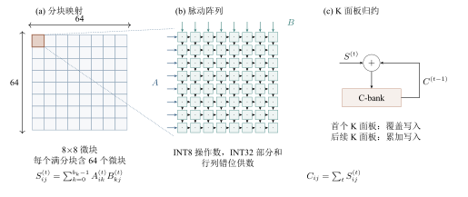

图3  一个64×64逻辑输出分块由64个8×8微块组成，由同一物理阵列分时处理。A沿行、B沿列传递；PE形成当前K面板的局部部分和，C-bank跨K面板归约。图(a)每格为微块，图(b)每格为PE。

## 3.2 从供数到重叠

**K-major面板。** 主机按照归约维与阵列lane所需顺序序列化面板，使接收侧能够按计算顺序供数。布局改变访问次序，矩阵的数学语义保持一致。输入传输字节（wire）由独立解码恢复操作数后核对。

**首K块覆写。** 每个输出块第一次写入时建立当前部分和，避免为旧C内容再执行整块预清零。后续K块使用同一块的累加状态，既减少清零成本，也明确了每个job的初值来源。

**输入预取。** 在现有处理推进时准备下一面板，以减少计算等待输入的串行区间。预取的效果用对应版本周期及DMA+PL测量验证。

**双C-bank输出。** 结果银行由所有权状态约束写入和读回。当前块的计算与前一已完成块的输出可以分处不同银行运行，减少输出对下一块计算的阻塞。机制示意如下，时序宽度不按比例绘制：

```text
串行：       计算A → 输出A → 计算B → 输出B
结果重叠：   计算A → [计算B 与 输出A] → 输出B
```

C存储实现也影响资源和时序。早期一份流水写回方案虽通过功能仿真，却被综合为大量LUTRAM，未满足预期BRAM资源门，团队据此撤回该方案。后续设计以明确端口时序和银行所有权组织累加与读回。[E26]

图4展示K-major排列、同job预取和C-bank状态转换。

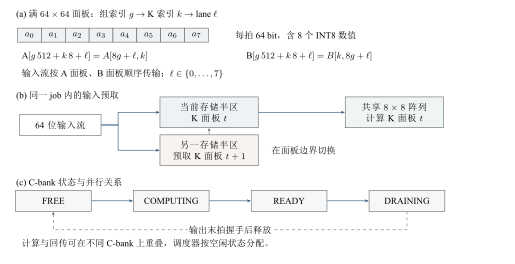

图4  满64×64面板按group、K索引和lane排列。预取发生于同一job内，输入存储在面板边界切换。C-bank从FREE到COMPUTING、READY、DRAINING，末拍输出握手后释放；图示为逻辑关系，不按实测周期绘制。

## 3.3 链格式、分块和DMA合同

链记录由64 B头部（header）和有效载荷（payload）组成。当前头部按`<16I`编码，即16个小端32-bit字。任务身份、几何、标志与长度等语义由冻结解析器确定。布局版本与执行MODE分别校验，保证主机和PL对同一批字节具有一致解释。[E24]

表4  链格式与DMA接口合同

| 接口内容 | 作用及检查 |
| --- | --- |
| 矩阵M/N/K、输出偏移及块几何 | 描述有效计算区域，界定尾块与K维归约 |
| job_id与链末标志 | 绑定执行顺序，定位任务及批次结束 |
| 布局/版本、融合相关标志 | 选择相容的解析和算术路径 |
| 输入/输出有效及传输长度 | 核对DMA长度、对齐和根缓冲容量 |
| 模式、启动与状态寄存器 | 控制执行并检查完成、错误和能力身份 |
| 工作计数及失败块索引 | 复核工作量、周期关系和错误位置 |

多个job在主机端拼接为整链，各DMA通道按整链提交。任务块描述计算几何，整链决定DMA提交粒度。已有实现采用`allocate`并复用连续物理缓冲。CPU写入完成后与提交/回读相应的缓存维护遵循PYNQ缓冲语义[R4、R5]。

Pointwise的125×64×64例子给出了一个完整接口实例：首job计算64行，尾job计算61行，尾面板最后3行补零。输入总长16,512 B，包括16,384 B payload及两个64 B链头；返回32,000 B，即8,000个INT32。每次有效工作量为512,000 MAC。有效工作量、补零传输与header开销分别计数。[E23、E24]

## 3.4 量化校正与逐级验证

新DS-CNN Pointwise输入零点为−128，权重与偏置沿用冻结模型。硬件先返回整数点积，ARM再还原中心化累加值：

\[
\begin{aligned}
R_{m,n}&=\sum_k qA_{m,k}qW_{k,n},\\
S_{m,n}&=R_{m,n}+b_n+128\sum_kqW_{k,n}\\
       &=\sum_k(qA_{m,k}+128)qW_{k,n}+b_n.
\end{aligned}
\]

随后按冻结逐通道尺度、带符号双重舍入、输出零点和激活规则产生INT8结果。通用量化规格解释尺度与零点的含义，具体整数舍入由模型参数、冻结实现和逐值复算共同确定[R7]。

检查按raw INT32、校正INT32、最终INT8三级进行。一个raw最低位错误可能在ReLU或饱和后仍得到−128，末端INT8相同会掩盖该差异。先核raw可以将它定位到返回算术阶段。单比特反例保留这一顺序的必要性。[E23]

## 3.5 并行计数如何解释周期

MODE11采用`d007_global_work_v2`，在全局时间轴上记录load、array、store、output四引擎的成功工作事件。每周期同时工作的引擎数为n时，重叠信用增加`max(n−1,0)`，因此有：

```text
sum(engine_work_cycles) = work_union_cycles + overlap_credit_cycles
total_cycles = work_union_cycles + no_work_cycles
```

这些关系把并行事件和总时间连接起来。四引擎工作量允许重叠，不能直接作为四段互斥时间求和；array/output重叠另受两者工作量较小值约束。正常运行记录版本为2，成功失败块哨兵为65535；0仍是有效的首失败块索引。`close()`软复位后、尚未再次启动的硬件初始身份版本为1，与运行记录分阶段验收。[E05、E21、E22]

## 3.6 RTL行为与工程验证

仿真把计算结构展开到每一个时钟沿。固定8×8核心用两组外积检查数据流：每组激活为8×1列向量，权重行为1至8；首组激活为1，次组为2，因而结果行分别为1至8和2至16。图5选取近端、同行远端和对角远端的PE，能直接观察输入传播、乘积寄存和本地累加之间的依拍关系。[E41]

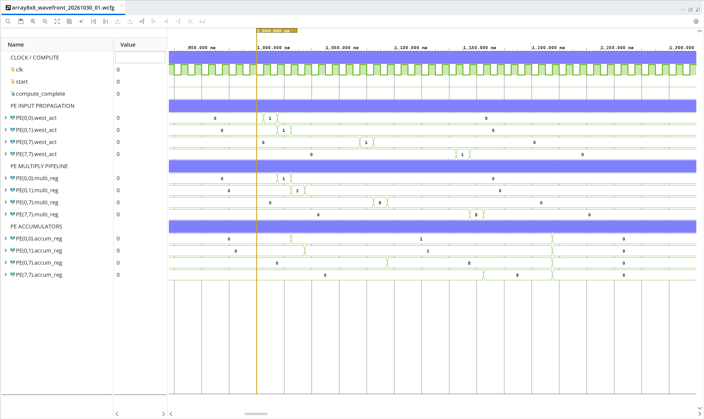

图5　8×8阵列的Vivado原生仿真波形。固定测试台以M=N=8、K=1驱动真实计算核心；图示首块中，激活沿阵列传播，乘积与累加随后更新。PE(0,0)的输入、乘积和累加分别在1005、1015和1025 ns出现，PE(7,7)对应时刻为1145、1155和1165 ns。时钟周期10 ns。[E41]

双bank设计把结果存储的所有权分开。首块完成计算后，bank0进入排空；下一块复用同一阵列并写入bank1。图6中compute_bank=1、drain_bank=0，store_write_valid与有效读回重叠，overlap_count从0增至16，输出拍数持续推进。固定测试台同时核对两块结果、64个输出拍和末拍标志。[E41]

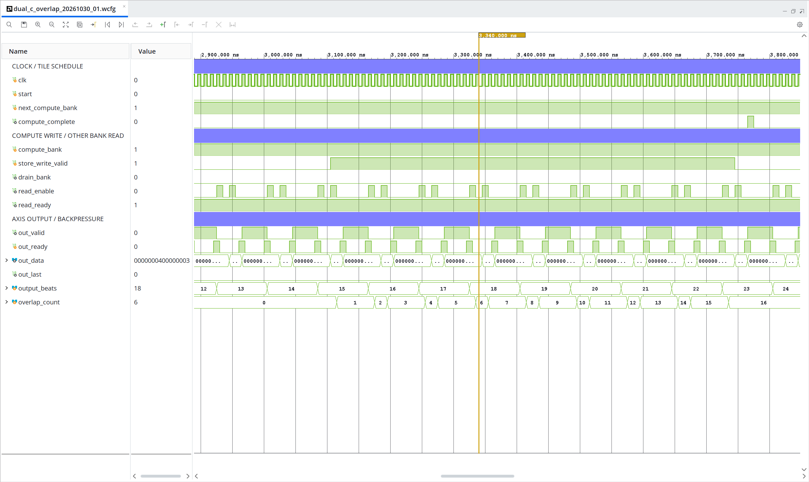

图6　双C-bank计算写入与结果读回的原生波形。约3105–3735 ns期间，计算结果写入bank1，bank0的读回仍在进行；计数器记录16次不同银行的PE写入与有效读回重叠事件。两块用例共输出64个64-bit拍，2次计算完成，fail=0。[E41]

输出端还必须适应接收方停顿。图7把握手放大到可读数据值的尺度：当valid有效而ready撤销时，数据与末拍信息保持；在有效时钟沿完成握手后，输出计数才前进。测试台用稳定性断言和逐拍整数参考共同检查该行为，并检查局部软复位后的旧拍取消。[E41]

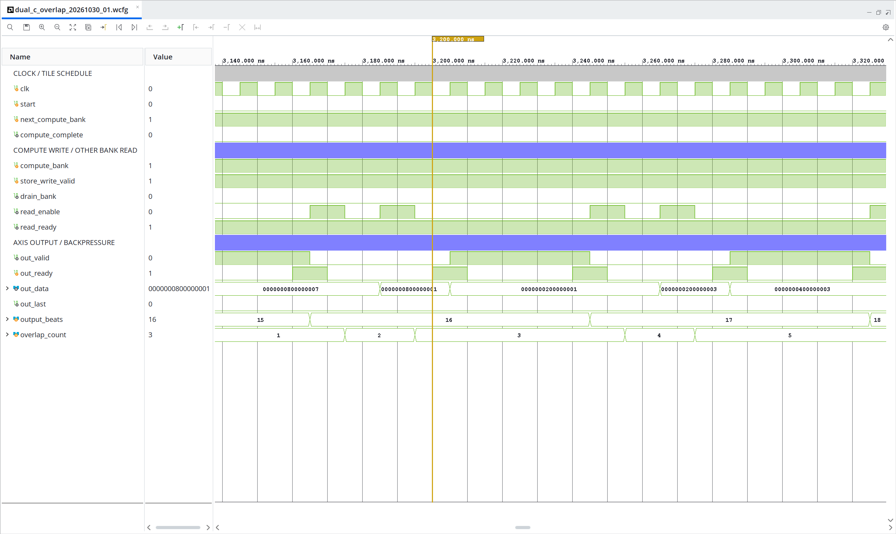

图7　AXI-Stream输出背压局部。约3210–3240 ns内out_valid=1、out_ready=0，out_data保持0000000200000001；有效时钟沿握手后output_beats才推进。图中read_enable/read_ready属于C-bank读接口，out_valid/out_ready属于输出接口，两组握手分别解释。[E41]

本轮对既有测试台的离线重放保留原始输入和每条命令退出记录：PE单元30项检查通过，AXI包保护21项通过，双bank用例以fail=0结束。另保留的历史MODE11随机回归含31组情形、31,002次元素配对，MMIO回归读到build=2026d075、caps=00080efe，独立INT8重定量化流水含1,016项检查。单元、集成和板端记录分别核对对应范围；固定用例重放不增加独立测试方法数。[E41]

# 4 优化设计与受控实验

## 4.1 实验方法

优化路线总览（各行使用独立对照，不累计收益）

| 层次 | 机制与解决的问题 | 已有结果及来源 |
| --- | --- | --- |
| 计算与供数 | 8×8物理阵列承担64×64逻辑块；K-major按消费顺序送数 | 同BIT512³ DMA+PL 106.687→63.972 ms [E02] |
| 初始化与预取 | 首K覆写取消独立清零，计算期间预备下一面板 | 512³总周期分别减少262,144与459,200 [E03、E04] |
| 计算/输出重叠 | 双C-bank及MODE11调度 | 同BIT512³ DMA+PL 36.221→31.262 ms [E05] |
| 主机请求复用 | 复用面板及不可变布局，减少事务生成 | 512³完整请求714.535→284.216 ms，−60.22% [E06] |
| 后续主机细化 | flat与连续面板；10/31独立复现 | 两场512³分别−10.76%、−9.54%；复现−8.78% [E09、E10、E42] |
| 应用与工程 | CPU420→单层→共享中段→完整PC图，配套构建、波形和Skill | 共享12窗768,000检查点一致；完整PC图865,680标量复算 [E16–E22、E30–E34] |

后续各节分别给出硬件、主机与应用证据。总览中的DMA+PL、周期和完整请求采用不同窗口，保留各自版本与基线。


实验同时保留正确性和性能两个维度。输入在主机和设备端保持相同整数语义，完整输出由黄金结果核对。性能以固定工作量、预热、线程设置及后端执行次序比较。外部独立INT64重算单列，不给某一后端额外计入独立oracle成本。

表5  实验观察边界

| 观察边界 | 内容 | 主要用途 |
| --- | --- | --- |
| 纯PL窗口 | 硬件计数的执行周期 | 分析阵列、等待和引擎重叠 |
| DMA+PL窗口 | 主机观察到的DMA启动、设备执行及完成等待 | 评价传输与硬件执行通路 |
| 完整请求 | 转换、构帧、调用内检查、同步、提交/等待、计数读取及拆包 | 比较用户一次矩阵调用的实际代价 |
| WAV/MFCC与模型 | 音频特征和推理阶段 | 评价应用计算路径 |
| 完整保存能量包络 | 仪表保存窗口内整条服务过程 | 描述同工作量服务批次的能量观察 |

完整请求排除进程启动/import、资源准备、外部IPC、独立oracle和证据落盘。初始化与冷启动另列。下文速度比均使用同一行对应的观察边界。原始慢点与失败记录全部保留。

## 4.2 硬件单步优化

历史版本围绕接收、清零、输入等待及结果输出逐步改进。表6中每行内部为受控比较，行间属于不同版本。[E02–E05]

表6  硬件优化机制及实测结果

| 机制 | 版本内主要变化 | 对应实测结果 |
| --- | --- | --- |
| D006-2 K-major | receive由4,790,400降至530,560周期 | DMA+PL由106.687降至63.972 ms，接收阶段约9.03倍 |
| D007-A2首K覆写 | 总周期4,239,808→3,977,664 | 少262,144周期，配对DMA+PL约省2.601 ms |
| D007-P输入预取 | 总周期3,977,664→3,518,464 | 少459,200周期，配对DMA+PL约省4.552 ms |
| D075 MODE11 | 同BIT比较MODE10/11，20次配对 | 512³ DMA+PL 36.221124→31.261776 ms，约1.159倍 |

注：接收阶段的速度比用于解释供数机制，各行按对应版本独立比较。

D075沿用K-major供数、首K块覆写和输入预取，以双结果银行进一步组织计算与输出重叠。优化从接收寻址、部分和初始化推进到引擎调度，每一步都对应可定位的等待或搬运成本。

MODE11该场DMA+PL有效吞吐为4.293349 GMAC/s，一个MAC计一次。纯PL为3,004,483周期，即30.044830 ms，对应4.467249 GMAC/s。按64个PE、100 MHz、每PE每周期一个MAC计算，阵列理论峰值为6.4 GMAC/s。512³理想工作下限为2,097,152周期。纯PL有效吞吐与理论峰值的比为69.80%，这一派生比值综合了启动、等待及输出等成本，表示有效吞吐相对理论峰值的比例。[E35、E37]

## 4.3 完整实现与资源代价

D075在干净目录完成综合、布局布线、BIT写出和导出，47个构建输入逐字节对应，未复用旧IP/DCP结果。最终工作频率100 MHz，setup WNS/TNS为+0.118 ns/0，hold WHS/THS为+0.066 ns/0。72个DSP分属64个阵列PE、7个量化单元和1个事务计数器。[E01]

表7  完整集成实现资源对比

| 完整集成版本 | LUT | FF | BRAM Tile | DSP |
| --- | ---: | ---: | ---: | ---: |
| D007-P（D074） | 24,289 | 25,050 | 7 | 72 |
| D075 | 26,762 | 27,575 | 11 | 72 |
| 集成增量 | +2,473 | +2,525 | +4 | 0 |

注：差值反映两套集成实现，双bank和计数等机制没有单独面积消融。[E35、E36]

图8按器件容量比较两套完整实现的资源占用。

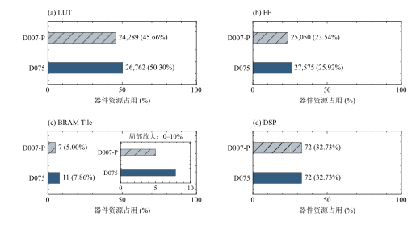

图8  D007-P与D075两套完整集成实现按同一XC7Z020容量归一化；柱末给出资源数量及占比。四个主轴均为0–100%，BRAM附0–10%局部放大窗。斜线表示参考实现D007-P。完整数量见随图CSV和正文对比表。

构建成员在另一电脑完成CMD路径的完整构建，返回产物的配置载荷与参考一致，来源端ZIP SHA也已补齐。BIT头部含日期/时间，重建比较将整文件与配置载荷分开，保留4,045,564 B载荷逐字节一致的记录。完整实现的DDR preset、DMA RAM Advisory及方法学/DRC条目一并交付。152条TIMING-46有对应setup/hold逐路径核查。[E18、E19]

工程版本以固定源码和配置载荷识别。九月底形成的D075硬件在十月继续承担矩阵、Pointwise及共享链实验；后续主要改进主机数据组织和应用接线。10月13日干净重建核对47份输入，完整资源与自然时序报告正文一致，BIT仅时间头变化，4,045,564 B配置载荷逐字节相同。构建成员随后在另一电脑完成同配置完整构建及来源端ZIP回核。硬件基础与十月各阶段运行成果由各自来源记录绑定。[E01、E18、E19、E21]

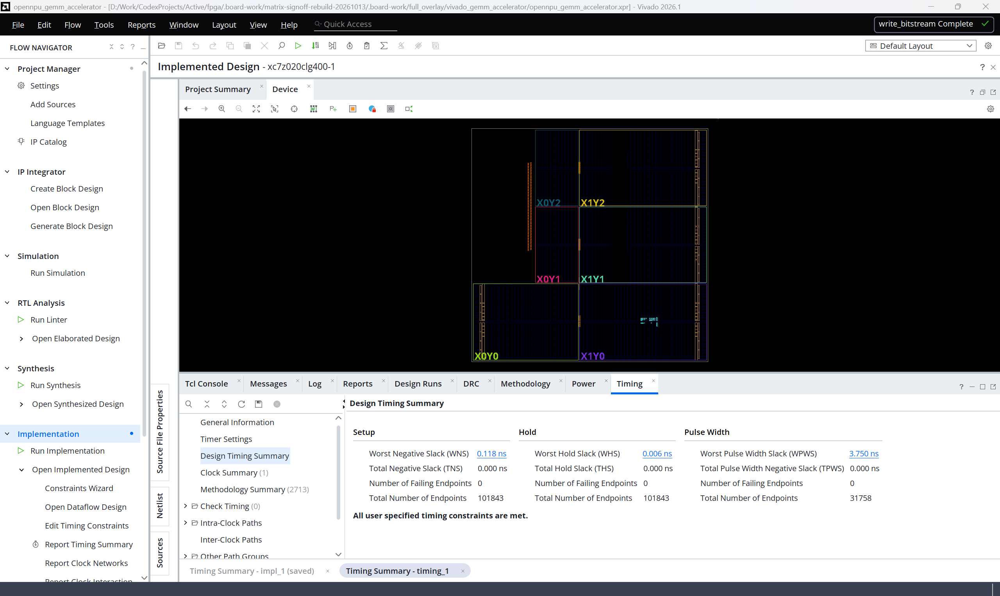

图9　同一D075路由检查点的原生时序窗口。此视图保留实现阶段额外0.060 ns最小延迟要求，WNS=+0.118 ns、WHS=+0.006 ns，TNS/THS均为0；恢复原0 ns要求后的自然约束签核报告为WHS=+0.066 ns。两份原报告分别保留。[E01、E41]

图9呈现实现过程使用的较强保持约束；正文资源表对应的自然约束结果仍为WNS=+0.118 ns、WHS=+0.066 ns。0.060 ns要求的差异恰好对应两份保持裕量之差。工程同时保留厂商DDR preset相关PSU告警、DMA RAM Advisory和152条TIMING-46的逐路径核查。[E01、E41]

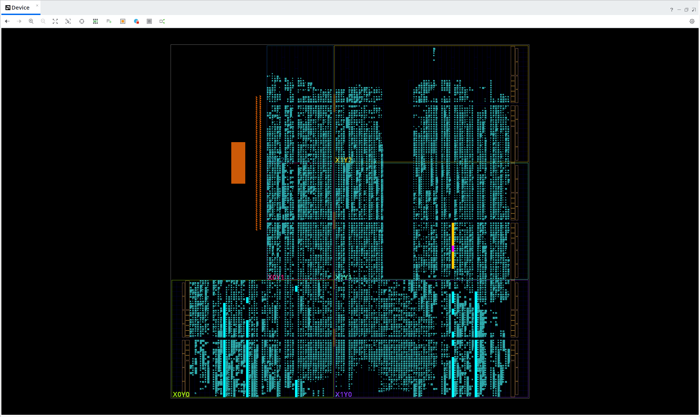

图10　D075已实现设计的Device资源分布。按已放置网表逐项核对，64个PE乘法DSP以青色高亮，7个量化DSP为橙色，1个工作量计数DSP为紫红色，72个物理DSP站点互不重复。背景中的青色已放置逻辑同时包含LUT/FF等资源，DSP用途以对象与站点清单判定。[E01、E41]

物理网表进一步把资源数字落实到具体对象。64个阵列乘法器、7个量化乘法器与1个工作量计数器共占用72个DSP48E1，各自站点记录与图10的高亮对应。实现中的层次优化可能把相邻逻辑归入同一名称前缀；随附PE原理图按实际数据连接选取单PE乘法器及一级相邻逻辑，保留SVG/PDF供放大查阅。[E01、E41]

## 4.4 片上容量、复用与传输代价

D075以输出驻留和流式任务组织片上数据：K维部分和留在当前输出块中，A/B面板按输出job送入阵列。11个BRAM Tile占器件140个的7.86%，资源余量为进一步探索片上操作数复用提供了空间。主机缓存已复用重复面板的打包结果，当前wire仍按job携带相应输入。

512³的两份原始INT8输入共524,288 B。现有64个job发送4,194,304 B输入payload，为原始输入的8倍，另有4,096 B链头和1,048,576 B INT32输出。wire共有1,024次面板出现，请求内独立打包为64次A面板与64次B面板。输入payload比值量化协议传输冗余；DDR总流量与带宽需另行测量。[E35、E37]

按134,217,728个有效MAC计算，只计原始输入、计必要输入加输出、计实际wire输入加输出三种边界的算术强度依次为256.0、85.33、25.58 MAC/B。最后一项含链头。该推导揭示布局的流量代价，外存带宽与等待之间的定量关系留待专项测量。

跨job驻留A/B将涉及新的地址、调度和银行合同，需要与现有接口另行设计。本文把它列为明确的后续方向。当前两轮主机优化保持D075不变，先利用已有数据通路获得实测改善。

## 4.5 主机成本与请求内复用

硬件窗口缩短后，完整请求主要还要承担数据转换、构造和重建。历史483调用实验在7种形状、各20组正式输入上比较三后端：512³原FPGA请求均值714.535 ms，请求内面板与不可变布局复用后为284.216 ms，减少60.22%。DMA+PL约31.018→31.079 ms，变化落在主机侧。[E06]

缓存以单次请求为边界，复用同一请求的面板和几何，保持跨请求输入可变。随后团队以优化OpenBLAS建立更强ARM基线。10/17收口的320调用实验含128预热和192正式调用，每形状每后端24正式点，独立INT64核对52,428,800个INT32位置。[E07]

表8  主机路径与CPU后端成本

| 尺寸 | 旧NumPy ms | OpenBLAS 1t ms | OpenBLAS 2t ms | cached FPGA ms |
| --- | ---: | ---: | ---: | ---: |
| 256³ | 62.668 | 41.687 | 24.672 | 51.667 |
| 512³ | 436.841 | 298.523 | 166.178 | 279.358 |

512³相对单线程CPU有23/24配对更快，相对双线程为0/24。256³也未超过优化CPU。更强基线促使后续工作继续定位完整请求，而非只报告相对旧NumPy的优势。

## 4.6 flat构帧与连续面板

flat构帧改变任务链字节的主机组织，保持DMA提交主体和数值核验要求。10/21实验中，512³的owned submission由139.972降至111.548 ms，是主要变化区域。该区间包含构帧及前后检查，实际改进按整个区间描述。[E09]

连续面板候选进一步改变非连续视图的序列化方式：

```python
# 原路径
raw = view.tobytes()
# 连续面板候选
raw = np.ascontiguousarray(view).tobytes()
```

两者按相同C-order逻辑索引导出INT8字节。先物化连续数组可以改变底层搬运方式，代价是增加一次临时数组分配，单面板显式数据区上限4,096 B。该值描述单个显式临时数组的数据区，进程RSS需独立观测。离线穷举和银行核对先确认字节等价，再由ARM同场测量判断净收益[R6、E10、E11]。

表9  两轮独立实验的完整请求对比

| 实验 | 尺寸 | 本场FPGA基线 ms | 候选 ms | 本场OpenBLAS 2t ms | 对基线耗时变化 |
| --- | --- | ---: | ---: | ---: | --- |
| 10/21 old→flat | 256³ | 57.296 | 57.693 | 25.163 | +0.69%，未见改善 |
| 10/21 old→flat | 512³ | 272.113 | 242.822 | 172.241 | −10.76% |
| 10/22 flat→连续面板 | 256³ | 58.733 | 52.672 | 25.342 | −10.32% |
| 10/22 flat→连续面板 | 512³ | 266.977 | 241.510 | 171.555 | −9.54% |

注：每轮12块、72调用，含24预热和48正式；每尺寸每后端8个正式点。两组后端次序为基线→候选→CPU与CPU→候选→基线，输入银行42/43重复使用。各轮以本场基线为分母，10.76%与9.54%分别报告。[E09–E11]

10/21的8个512³ flat正式耗时全部低于8个old耗时，两个执行次序块均有改善。该场512³进程CPU时间从246.744降至217.794 ms，较old少11.73%，较双线程CPU少35.13%。256³在本场没有改善，结果随尺寸和主机机制而异。完整请求的改善与进程CPU时间的降低共同说明主机组织优化的效果。同场双线程CPU仍具有更短的完整请求耗时，系统成本对照见表9。

图11将两场完整请求与各自CPU基线分别呈现。

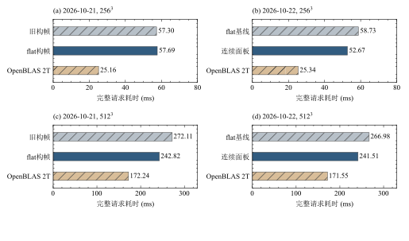

图11  每条件8个正式请求，两场实验、两种尺寸及各自同场双线程OpenBLAS分别展示。斜线为参考实现或对照后端，深蓝实心为当场FPGA候选。10月21日256³未改善；两个512³候选缩短请求，但完整请求仍慢于当场CPU基线。

每轮运行时72次逐次核对及12个子进程的正常退出、资源清理和同inode锁释放均通过。各轮实际保存12份预定代表输出供离线独立INT64核对，离线独立核对范围以实际保存的代表输出为准。这里报告正常路径完成，停止注入与异常恢复由相应离线或历史实验另行记录。

## 4.7 阶段分解怎样支持机制解释

10/22的512³外层分解显示，连续面板使事务构造从95.454降至71.131 ms，其他外层区间接近原值。DMA+PL为30.849→30.966 ms，主要收益来自输入事务组织，与候选修改位置一致。

表10  10月22日512³完整请求阶段分解

| 512³观察区间 | flat基线 ms | 连续面板 ms |
| --- | ---: | ---: |
| 事务构造 | 95.454 | 71.131 |
| owned submission | 112.832 | 111.716 |
| 记录重建 | 32.182 | 32.093 |
| 输出拆包 | 19.130 | 19.219 |
| 四段求和 | 259.598 | 234.159 |
| 未归类残差 | 7.379 | 7.351 |
| submission内chain_total | 50.361 | 49.903 |
| chain_total内DMA+PL | 30.849 | 30.966 |

注：前四段加残差对应完整请求，最后两行是嵌套观察，不参与外层求和。细粒度计时存在观察开销，残差不指定为IPC、调度或解释器成本。两场图源由`experiment`列分开，10/21的flat值与本场基线分别使用。[E38、E39]

图12同时给出两场512³外层阶段分解及完整分段数值。

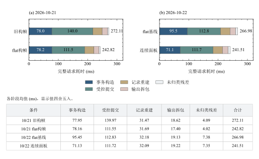

图12  每条件8个正式请求的均值；上图显示五段构成，下表给出全部20个阶段均值及4个总量，显示值四舍五入。各段位置顺序与图例、表列一致。DMA+PL为受控提交内部窗口，不另加为第六段。

## 4.8 一次未采用的原生构帧候选

`native_prepared`曾在PC局部步骤表现较快，但实板7/7形状的完整请求更慢，512³从283.486增至416.921 ms，增加47.07%。团队保留结果并停止长测，继续选择已通过字节等价和完整请求验证的最小改动。[E08]

这次结果使团队将完整请求作为采用候选的裁决依据。跨语言实现需要同时衡量构造、检查和调用边界，PC局部计时用作筛选。目前尚无细分证据把该退化唯一归因于某个函数。

# 5 同工作量能量诊断

## 5.1 测量设计

10/24使用UT70和10SPS上位机，以CPU→FPGA→FPGA→CPU的ABBA顺序采集四窗，FPGA采用`flat_contiguous`。每窗452正式调用、4预热，总计1,808正式和16预热，预热在正式保存之前完成。唯一主供电及外设状态按现场合同固定，两端握手绑定同一计划；失败会话单独保留。[E12、E13]

测量对象是完整CSV保存包络，包含控制、缓冲和核验等成本。分别计算累计Wh端点能量与时间戳功率梯形积分：

\[
E_{Wh}=3600(Wh_{last}-Wh_{first}),\qquad
E_P=\sum_i\frac{P_i+P_{i+1}}{2}(t_{i+1}-t_i).
\]

CSV表头mV/mA采用事前冻结的条件V/A数值解释，检查电压范围和P=VI一致性。事前`1.01 J AND 0.001`预算检验同源累计量与积分的一致性，并非仪表误差界或组间差异显著性门限。

## 5.2 四窗结果及其含义

表11  ABBA四窗完整保存包络

| 窗口 | 后端 | 正式调用 | 保存跨度 s | Wh端点能量 J | 功率积分 J |
| --- | --- | ---: | ---: | ---: | ---: |
| 0 | OpenBLAS 2t | 452 | 132.7 | 261.1152 | 261.042078 |
| 1 | FPGA | 452 | 138.9 | 257.9184 | 257.898188 |
| 2 | FPGA | 452 | 140.4 | 260.0388 | 260.040935 |
| 3 | OpenBLAS 2t | 452 | 134.7 | 264.2724 | 264.245073 |

CPU与FPGA的Wh端点均值为262.6938 J和258.9786 J，本轮低3.7152 J，即1.4143%。功率积分均值为262.643575 J和258.969561 J，低1.3989%。两种口径给出接近的方向。

图13保留四窗能量原值，并显示同组ABBA均值差。

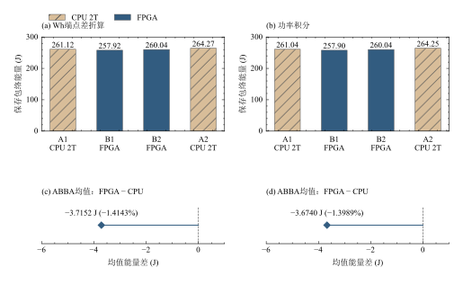

图13  单组ABBA四窗按CPU、FPGA、FPGA、CPU采集，每窗452次正式调用，预热在保存前完成。上排保留完整保存包络的能量读数，纵轴从零起；下排给出mean(B1,B2)−mean(A1,A2)，Wh端点与同源功率积分分别为−3.7152 J（−1.4143%）与−3.6740 J（−1.3989%）。两种核算来自同一次四窗采集，不视为独立复验，不折算单次调用或推断误差条。

当场904个CPU正式请求均值170.5267 ms，904个FPGA正式请求为220.4783 ms，FPGA慢29.29%；进程CPU时间均值331.8055→195.3539 ms，减少41.12%。CPU时间描述进程累计消耗，整机空闲率与并发能力属于另外的评价指标。重复请求使用两组矩阵。

本轮结果是单组ABBA完整保存包络的正向能量观察。两种累计方法使用同源仪表，且保存跨度不同；稳定节能与计量精度需要重复配对和独立校准。统计保持完整包络，不扣空闲、不截取活动区，也不除452生成精确单任务能量。

10/19旧cached候选曾得到317.1672 J，高于当场CPU的272.5614 J。该负结果按旧候选与当场条件保留。两次实验不作跨日因果减法。新实验的1,824条运行记录、912条FPGA计数、4份CSV和8份预定代表输出均已复核，独立点积只对实际保存的8份全输出进行。[E12、E13]

# 6 KWS应用：从整数参考到共享计算会话

## 6.1 应用验证要解决的问题

DS-CNN将深度卷积与逐点卷积分开：depthwise在各通道内提取空间特征，pointwise以1×1卷积混合通道。该结构已用于资源受限设备的KWS研究[R8]。两种操作对数据组织的要求不同，适合检验通用矩阵核与CPU算术之间的划分。项目选择新DS-CNN的Op2、Op4作为Pointwise映射对象，CPU保留其间的depthwise3。

应用工作依次回答三类问题：前处理能否产生相同INT8特征，整数图能否逐层对齐，分类与门控能否满足使用要求。旧三层模型和新DS-CNN的结果按模型身份分开。旧模型固定120条107/120的实板记录及一次麦克风工程链作为历史来源保留。该次实录预期yes、预测off，因low_score被拒绝。[E05、E15]

## 6.2 前处理差异与ARM CPU420

最初DS-CNN前处理有47/420窗出现差异，共1,184/205,800个INT8特征不一致。后续另名数值路径保持公共WAV及冻结参数，将全部205,800个INT8特征对齐。浮点MFCC与量化特征采用各自比较层级，INT8完全相等并不要求浮点中间量逐位相同。

PC固定420窗整数参考运行时核对30,298,800个INT8中间值和5,040个logits。10/23 ARM CPU420从公共WAV重新执行前处理及完整CPU整数链，保留特征与logits分别与PC参考逐字节一致。[E14、E16]

ARM前处理平均2,031.107 ms，模型整数参考平均1,160.126 ms，两段合计3,191.233 ms/一秒音频窗。该参考实现提供可追踪的端侧算术与成本基线，当前尚不实时。前处理是主要成本，为后续应用优化给出了明确对象。上述两段计时覆盖特征与整数模型计算，启动器准备与收尾另计。

## 6.3 分类与动作门控

表12  固定420窗模型比较

| 固定420窗比较 | 旧三层模型 | 新DS-CNN |
| --- | ---: | ---: |
| 原始分类正确 | 350/420 | 383/420 |
| 目标口令分类正确 | 270/300 | 268/300 |
| unknown分类正确 | 60/100 | 95/100 |
| 原规则下目标正确放行 | 215/300 | 214/300 |
| 负例误动作 | 5/120 | 0/120 |
| 错误目标口令放行 | 5 | 1 |

新模型原始分类为91.19%，改善主要来自unknown类别。目标口令正确数略降，54条分类正确的目标又被低分拒绝，造成18个百分点的正确放行损失，超过原探索性5个百分点上限。因此，原始分类提升和门控部署资格分别评价。[E14]

评分先按模型scale和zero point反量化logits，再应用原评分规则。INT8整数直接softmax或重复softmax都会改变评分语义。当前固定420窗、VAD与gap不变且只调整统一score切点时，既有两个探索性约束不能同时满足。生产门限保持不变。0/120为固定负例集观察，20个背景片段不等于20个独立环境。

## 6.4 单层映射怎样进入动态链路

Op2与Op4均可写为125×64乘64×64的矩阵乘法，但二者权重和张量身份不同。Op2计算tensor23→24，随后depthwise3计算tensor24→25，Op4才接收tensor25并生成tensor26。相同形状不能代替真实依赖关系。

图14对应完整PC图与真实共享中段的计算关系。

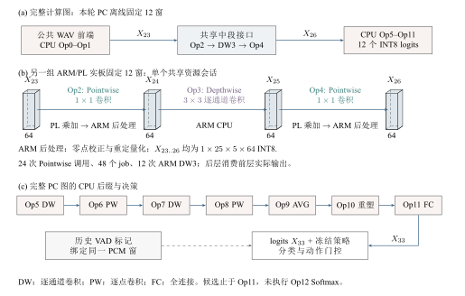

图14  图(a)为固定12窗完整PC离线图；图(b)为另一组真实ARM/PL共享12窗证据，输入tensor23来自冻结CPU前缀。两次Pointwise在PL完成MAC，ARM完成校正、重定量化及DW3，后层消费实际前层输出。完整候选止于Op11，VAD使用绑定本窗PCM的历史标记。

depthwise3按NHWC形状1×25×5×64执行3×3 SAME填充，以量化零点−128补入空间边界后中心化，逐通道计算及重定量化。结果展平为新的owning、C-contiguous `(125,64)`数组。`InputEnvelope`绑定算子、tensor、窗口和来源，提交前检查完整值，提交后再逆解码wire确认Op4输入确为当前动态结果。

跨层反例包含能够传播到DW3 INT8的单比特扰动，也包含被量化掩盖的负对照。上游检查定位扰动，raw核验防止末端量化相同掩盖返回错误，错层/串窗输入则在DMA提交前拒绝。[E21、E23]

## 6.5 真实共享12窗的结果

10/26在一次真实SharedOwner会话中完成固定12窗，索引为0、30、60、90、120、150、180、210、240、270、300、400。共24次交替Pointwise调用、48个连续编号1..48的job，Pointwise工作量12,288,000 MAC；ARM depthwise3调用12次，含空间填充逻辑工作量864,000 MAC。[E21、E22]

表13  共享12窗保存与复算规模

| 保存与复算对象 | 每类标量数 |
| --- | ---: |
| Op2 raw INT32、PS校正INT32、最终INT8 | 各96,000 |
| DW3累加器、最终INT8 | 各96,000 |
| Op4 raw INT32、PS校正INT32、最终INT8 | 各96,000 |
| 八类合计 | 768,000 |

全部标量零差异，264份二进制与冻结参考对应。运行中24条MMIO记录符合版本2、65535成功哨兵及工作守恒。父进程实际wait、真实组消失查询、一次close和同inode锁释放完成正常生命周期闭环。离线独审于10/27收口。

这次实验把两个正确的单层连接成同一资源会话内的真实PS/PL数据流。测量覆盖固定12窗三算子中段及正常完成，故障恢复和长稳仍引用各自历史入口，未在本轮新增。


### 现场运行与完成状态

2026年10月31日，平台在同一次开机中顺序完成矩阵对照与共享KWS中段演示。矩阵部分执行72次调用，其中24次预热、48次正式；共享中段执行12窗、24次Pointwise请求和48个job。两段启动器均以0退出，并保存正常清理记录。运行图1–3取自此次原始录屏。[E42]

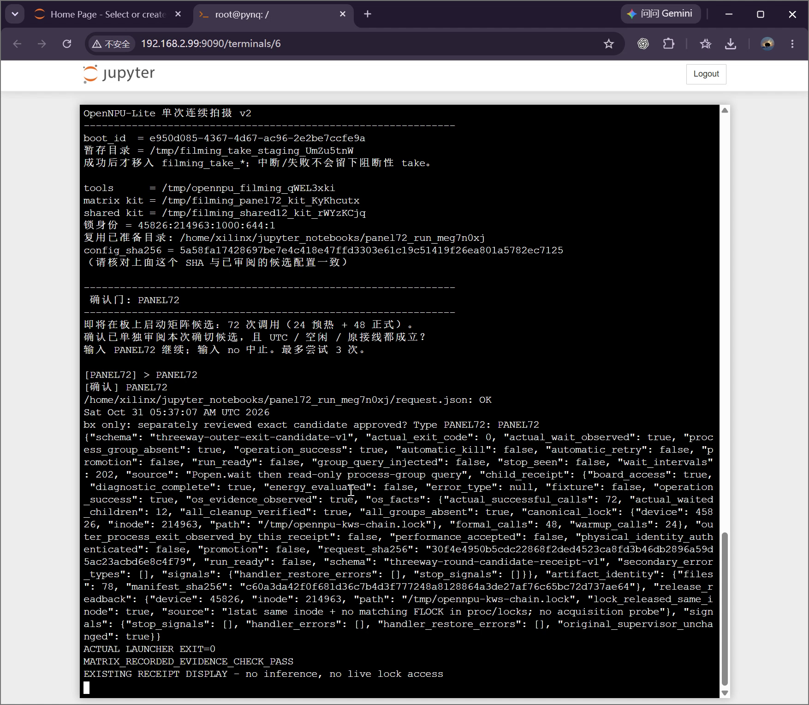

运行图1　矩阵测试完成画面（原始录屏04:15，局部）。回执记录72次成功调用、48次正式调用及资源清理通过，末尾显示启动器退出码0和记录核验通过。

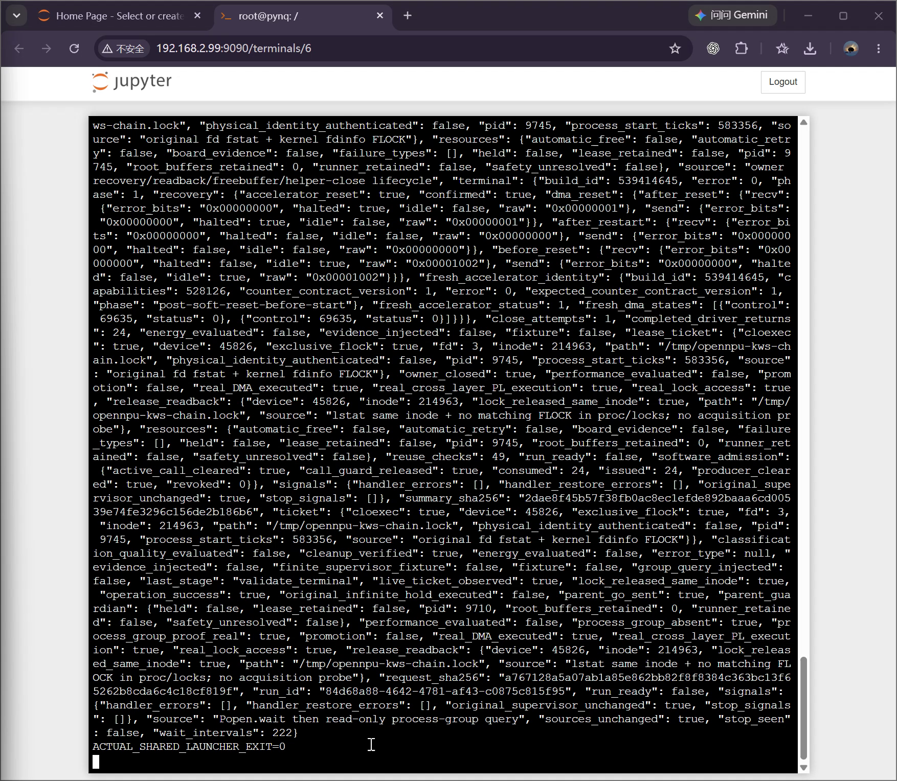

运行图2　共享中段完成画面（原始录屏09:39，局部）。终态记录真实DMA、真实跨层PL执行、同inode锁释放及清理通过，启动器退出码为0。

### 复现结果与现场装置

本次矩阵完整请求均值在256³下由57.601 ms降至51.742 ms，在512³下由261.115 ms降至238.188 ms，分别缩短10.17%和8.78%；同场双线程OpenBLAS均值为25.073 ms和166.295 ms。该组独立复现与10月22日结果方向一致，按当日场次单列。[E42]

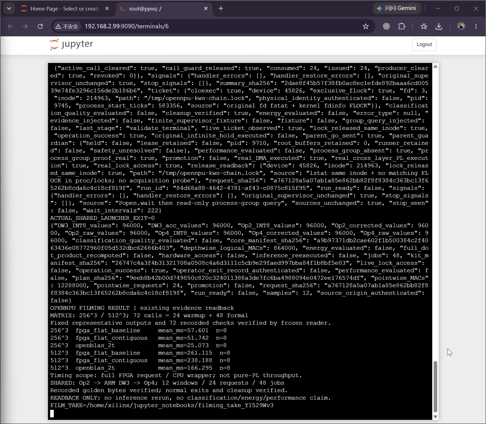

运行图3　完成后的只读结果汇总（原始录屏10:10，局部）。六组计时各含8次正式调用，末段汇总12窗／24请求／48个job；计时范围为完整FPGA请求或CPU包装入口。

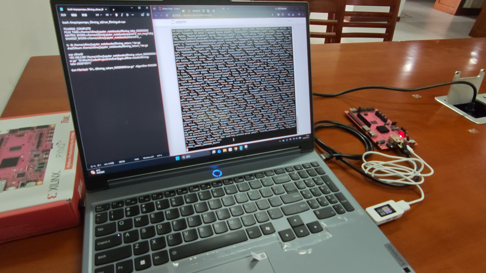

实物图3　连续演示现场的系统斜视画面。主机、PYNQ-Z2、UT70及USB供电和以太网通信连接同时入镜，取自手机原始录像09:28。

共享中段逐字节核对Op2的raw／校正／INT8、DW3的累加器／INT8、Op4的raw／校正／INT8，共八类768,000个检查点。此次记录用于复现数值返回、请求排程与正常退出；分类质量和能量结论沿用对应独立实验。录屏时间点和原件SHA见E42。

## 6.6 完整图固定12窗PC离线接线

在共享中段基础上，项目将CPU前缀与后缀接入现有接口，形成从公共WAV到分类建议的完整动态计算。逐窗重新计算49×10个INT8特征；CPU执行Op0、Op1生成tensor23；共享Op2、CPU DW3、共享Op4生成tensor26；CPU继续执行Op5至Op11，得到tensor33的12个INT8 pre-softmax logits。分类使用动态logits与原策略，VAD复用通过窗口、来源SHA和PCM SHA绑定的历史记录。[E30–E34]

本轮共享资源运行于PC `WireEnvironment`软件夹具，夹具从实际提交的K-major字节解码操作数后计算回包，原owner、一次性job准入及驱动调用链参与执行。黄金张量和既有板端输出作为事后核对来源，不回填被测数据流。

表14  完整PC混合图固定12窗验收结果

| 验收对象 | 固定12窗结果 |
| --- | --- |
| 动态WAV特征 | 5,880个INT8值与CPU420对应切片一致 |
| 最终pre-softmax logits | 144个INT8值与CPU420对应切片一致 |
| 共享资源与排程 | 1次start/close，24次Pointwise、48个job，ID 1..48 |
| 独立全图复算 | 标准库重算Op0..11的865,680个算子输出，一致 |
| 跨平台确定性产物 | 737份二进制与作者Linux产物逐字节一致 |
| 测试 | 17项单测0失败/0跳过，5项CLI负例均拒绝 |

扰动检查覆盖前处理、CPU前缀、DW3与最终logits，raw故障先于ReLU被拦截。窗90的停止和不确定返回场景分别保存完成数、permit消耗及实际返回数，软件unsafe夹具保持hold。Pointwise尾块的61有效行与3行零填充、DW3的SAME空间填充各按其算术边界验收。

固定12窗的动态评分得到8个正确命令放行；go→no和on→down两个已有错分因low_score拒绝，unknown及silence因model_noncommand拒绝。这是固定窗口对原模型和策略的行为重现。候选计算止于Op11的pre-softmax logits，评分使用这些动态结果，VAD采用已绑定PCM的历史记录。

函数流程按调用层级和实际数据依赖展开。完整PC候选由run_hybrid_candidate.py核对输入后调用run_hybrid_session；HybridGraphExecutor.run_prefix接收Frontend.process现算的49×10 INT8特征，执行Op0、Op1，输出独立拥有内存的125×64 tensor23。共享中段返回tensor26后，run_suffix继续执行Op5至Op11，生成12个INT8分类值tensor33。

SharedCall接收绑定窗口和张量身份的InputEnvelope，经SharedOwner.execute_chain、FlatPackPynqGemm.run_chain进入PynqGemm._submit_chain。每个Pointwise请求的有效输入帧为16,512 B，返回32,000 B原始INT32；返回后核对8,000个值，再完成偏置、零点校正和INT8重定量化。DW3接收Op2的动态输出tensor24，生成tensor25供Op4使用。上述函数流中，完整PC图使用WireEnvironment；已完成的真实ARM/PL共享中段采用同一驱动调用层级，现场输入及执行范围见KWS验证章节。[E21、E30–E34]

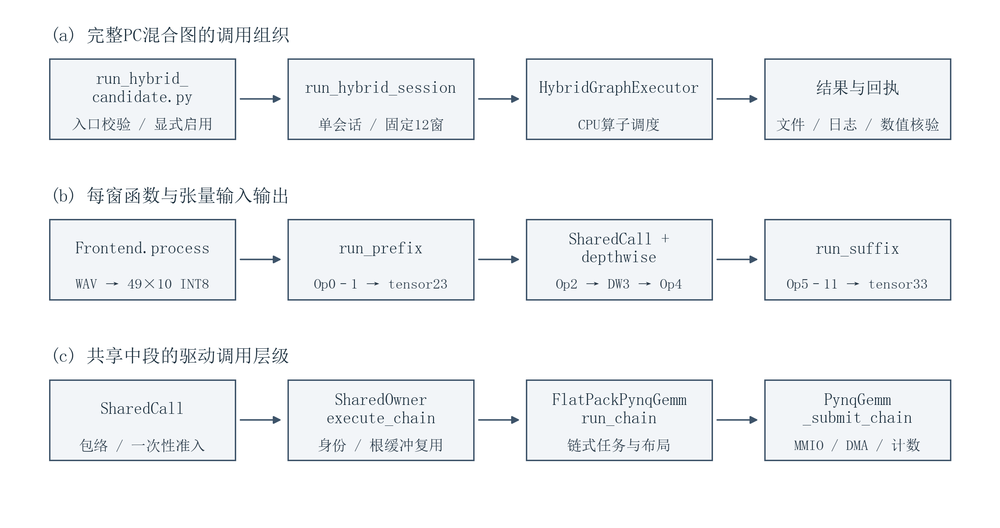

补图1　上两行描述完整PC混合图，第三行展开共享中段调用。图中输入输出由实际候选源码核对；完整PC图与真实共享中段的运行环境分别记述。

## 6.7 应用证据的覆盖范围

表15  三组KWS验证的对应关系

| 实验 | 执行环境与已验证内容 | 交付含义 |
| --- | --- | --- |
| CPU420 | 真实ARM，WAV前处理及完整CPU整数参考对齐 | 建立端侧数值基线及参考成本 |
| 共享12窗中段 | 同一资源会话内真实PL Op2→ARM DW3→PL Op4 | 验证跨层量化、动态传递及正常资源清理 |
| 完整图12窗 | PC动态前处理、前后缀、共享接口、分类及历史VAD门控 | 完成完整应用软件接线及独立算术复核 |

三类验证分别建立端侧数值基线、真实PS/PL跨层执行和完整应用软件接线，形成由通用矩阵接口进入模型计算图的工程路径。

# 7 团队主导的协同研发与Skill提炼

## 7.1 从设计要求到工程实现

团队围绕小型FPGA矩阵计算组织需求、设计、代码实现、测试与迭代，将阵列数据流、主机驱动和应用接线分解为连续的研发任务。在编码环节，负责人明确接口、函数边界及测试要求，结合代码级审查推动修订；编程模型按照这些要求辅助形成候选代码、脚本和反例。构建成员完成异机完整构建，复现成员回核验证工具的使用过程，团队据此判断实现质量并确定采用方案。[E17–E19、E21、E27、E40]

**团队对实现的参与落实在数据如何流动、代码如何调用、错误如何发现三个层面。** 在Pointwise接线中，负责人将运行期参考绑定确定为独立修补任务，要求覆盖四处直接或间接的`sources()`调用，保留模块身份及数学检查。针对跨层组合，负责人选定动态张量衔接方案，把Op2返回值、CPU depthwise3计算结果和Op4输入包络连成真实依赖。相关技术要求进入实现任务和回归条件，推动代码从单层调用发展为共享会话。[E23、E40]

团队把完整请求测量转化为具体优化任务，确定保持D075硬件、改进主机组织的阶段路线。在驱动与脚本迭代中，模块绑定、调用顺序和诊断字段被细化为修补要求，再交由源码审查和回归检查。应用接口则明确NHWC变形、量化参数及跨窗身份，使`InputEnvelope`检查和实际wire输入共同验证动态数据流。

构建成员在另一电脑另建CMD/BAT调用入口，完成综合、实现和生成物导出，核对时序、资源及配置载荷，并回核来源端ZIP哈希。复现成员在另一台电脑使用Skill处理十个既有案例，形成异机使用回件。现场实验中，负责人审定输入、执行次序和通过条件，组织反例验证，结合原始返回区分算术、状态和测试断言问题。[E17–E19、E23、E40]

负责人还承担实物接线、供电和网络确认、现场计划核对与主要板测，负责将离线方案落实到真实设备。10/26共享链采用经批准的浏览器辅助执行，负责人完成现场与本人确认，命令执行方式见E21。实现、实验和审查结果由团队汇合，作为候选采用及交付取舍的依据。

## 7.2 设计、实现和验证相互反馈

团队把设计要求落实为实现任务，并参与候选代码的审查、调试和测试修订。编码前先明确接口及允许修改的函数；编码过程中以具体调用路径、数组布局和异常出口指导模型辅助实现；运行后结合日志、返回数据及反例核对实现行为。每轮反馈形成下一版修订要求，由团队判断是否继续优化、保留方案或结束该项试验。

团队在各研发环节的具体参与及反馈关系见图15。

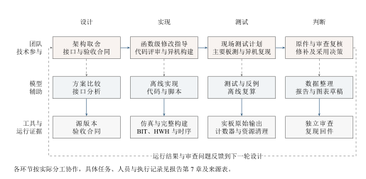

图15  团队贯穿设计、实现、测试与判断：函数级要求指导候选编码，代码审查和实测结果推动修订，异机构建与复现检查交付质量；编程模型辅助实现、脚本和反例。

团队的关键判断贯穿优化对象、评价方法和应用推进。512³硬件窗口缩短后，团队保持已验证硬件，将工作转向主机事务构造；以优化OpenBLAS建立CPU基线，并用完整请求评价候选。`native_prepared`在实板退化47.07%，因此终止后续长测。能量收益则独立组织ABBA四窗测量。[E07–E13]

新DS-CNN先建立ARM整数参考，再逐层映射；两层分别通过后继续检查动态衔接；raw核验先于最终量化，保留被ReLU掩盖的负对照。达到阶段目标后有界收口，将精力转入完整PC图与交付。上述八类判断的依据及结果分别见第4、5、6章。[E14、E16、E21、E23、E40]

## 7.3 技术协作案例与实现修订

下列案例按任务要求、模型方案、团队审查与验证结果组织，呈现具体技术问题如何进入代码修订和回归测试。[E27、E40]

**案例一：把参考模块修补落实到完整调用链。** 负责人针对owner初始化后PYNQ已驻留的运行条件，要求检查`derive`、调用对象构造、`make_jobs`及执行入口四条路径，统一使用冷进程阶段校验并绑定的参考。同时将错误位置细化为初始化前、窗口派生、调用构造和调用执行，并限制诊断字段。模型辅助实现和顺序回归，验证参考绑定能够跨越资源初始化保持有效。该任务把“解决导入失败”细化为覆盖具体函数、执行时序和异常出口的编码要求。[E40]

**案例二：以可构造反例改进IP身份检查。** Skill初版采用实例名辅助识别DMA。独立审查构造了实例名为`axi_dma_fake`、声明类型却为`not_a_dma`的模块，暴露启发式误判。负责人组织复核并确定修补范围，模型辅助重建输入、修改检查入口和补充回归。新版按精确MODTYPE/VLNV声明识别IP，并覆盖HWH-only输入、CLI参数及路径反例。后续Linux运行90个方法，0跳过通过。[E17、E27]

**案例三：用数据依赖要求推动跨层实现。** Op2与Op4具有相同矩阵形状，单层正确不能说明张量衔接正确。负责人选定Op2→CPU DW3→Op4路线，并将“消费上游实际输出”纳入实施要求。离线组合同时核对历史实板输出重放和当前夹具输出，经NHWC变形及DW3计算生成新的Op4输入，再逆解码wire检查实际发送值。单比特扰动及量化掩盖负对照验证了动态衔接。这一设计随后进入真实共享12窗运行，768,000个标量检查点一致。[E21–E23、E40]

**案例四：根据程序行为修正测试与分析。** 一次Linux回件中，软链接已经被程序拒绝，旧测试却仍要求异常文字包含`escapes`。核对源码与日志后，修补集中在断言及相关边界。另一处阶段分析把transfer/wait重复归入外层差额，回看计时起止点后确认它们已经位于`chain_total`内部。团队据此采用互斥外层加残差的耗时图，DMA+PL作为嵌套细节。[E17、E27、E38、E39]

这些修订将技术问题落实为函数边界、数据依赖和可执行反例，构成团队与编程工具协同完成工程实现的具体过程。

团队把审查问题写成具体实现任务。附录中的完整输出接线和四处参考调用清单，展示了要求如何进入代码；模型首轮引用错误及ticket采集次序的修正，则保留了实现自检与补测过程。原文和修订结果见附录C及[E43](evidence/e43.md)。

报告修订使用scientific-writing组织来源与章节核对，配合anti-defensive-writing和lieflat-less-ai-tone检查叙述；技术交互按来源核对，新增说明另行审校。相关程序化写作工作流参考Scientific Agent Skills[R9]，这些工具用于文稿与来源整理。

## 7.4 从工程经验提炼验证Skill

团队把项目中重复出现的检查需求整理为可执行的验证方法。每项Skill明确触发条件，规定输入资产和检查顺序，再以失败案例验证规则能否定位问题。模型辅助整理规则与检查脚本，团队通过审查和异机使用检验其可用性。

表16  项目Skill的提炼来源与方法

| Skill | 来自项目的具体问题 | 提炼的方法 |
| --- | --- | --- |
| `pynq-dma-validation` | IP名字与真实声明不一致，BIT/HWH或输入路径错配 | 先核资产及精确IP声明，再检查DMA长度和通路；以伪DMA、HWH-only及CLI反例验证 |
| `pynq-gemm-validation` | 面板布局或raw差异被后续量化掩盖 | 先固定算术与layout，再独立重算raw，最后核记录和量化输出 |
| `engineering-evidence-review` | 嵌套计时重复归因，摘要与原件不一致 | 定位计时起止、样本及来源，再复算相应主张 |

脚本层面，v3在Linux通过90个测试方法，0跳过。使用层面，复现成员在另一台电脑以AI辅助完成十个既有合成案例，原作者按事前40项语义标准评阅为40/40。两类验证分别覆盖检查器行为和异机使用过程，提供了Skill从项目经验转向可复用工具的实际记录。[E17及补充]

这些Skill的复用对象是同类工程接口。pynq-dma-validation适用于提供BIT/HWH且使用AXI DMA的PYNQ项目；pynq-gemm-validation适用于能够明确dtype、布局、块边界和整数参考的矩阵路径；engineering-evidence-review适用于具有调用起止、样本和原始记录的性能分析。规则依赖实际IP声明与算术合同，新设备或协议须先建立对应输入。异机十题验证覆盖既有合成案例的使用过程，提供可迁移方法的有限实证。[E17及补充、E27]

## 7.5 多层验证与工程收口

团队将算术、传输、实现和生命周期连接成分层验证体系。raw、校正值和INT8逐级检查定位数值差异；wire逆解码检查实际操作数；MMIO工作守恒解释硬件运行；完整实现报告和退出、释放记录分别检查时序与资源状态。错误返回、跨窗输入及停止反例进入回归，防止局部修补破坏相邻接口。

历史MODE11混合长稳完成1,800.008108 s、8,302对运行，对应当时硬件和入口。收口工具进一步覆盖cleanup深层身份，Linux新增21个方法、Skill90个方法均0跳过，统一PC入口9条子命令退出0。完整PC离线图另完成17项单测、5项CLI负例和标准库逐层复算。[E05、E29–E34]

团队据此把已验证功能、优化结果和复现资产整理为本次交付。各版本的长稳、同场性能和应用结果保留独立入口，具体适用条件及后续改进集中见第9.3节。

# 8 复现方法与交付组织

## 8.1 取得版本与准备环境

交付按`src/sim/build/board/data/skill/report`组织，`provenance`记录源路径、Git对象及导出文件SHA。公开仓库和正式Release提供完整工程，实验原件由各自冻结版本绑定；报告、仿真、构建资料、BIT/HWH与运行原件纳入同一顶层清单。附录B按公开下载、环境准备和逐层执行给出命令，工程内reproduction_guide.md提供可点击入口。

表17  分层复现入口与已有验证

| 层级 | 环境及入口 | 已有验证 |
| --- | --- | --- |
| 文件核验 | Python3.12+，导出根`reproduce.py`默认check | 文件集合、尺寸与SHA逐项检查 |
| PC软件 | 已测Python3.12.14/NumPy2.3.5，`pc`与`hybrid-smoke` | 公开获取后PC、一窗及固定12窗均已复跑；Windows平台跳过单列 |
| RTL仿真 | 固定D075源与TB，Vivado工具 | 历史完整回归日志；本轮4个固定用例重放 |
| 完整实现 | Windows Vivado2026.1、器件/IP许可、固定板定义 | 干净D075和构建成员 CMD构建；新v3包装未实际冷构建 |
| 板端复做 | ARMv7、Python3.10.4、NumPy1.21.5，当前现场新plan | 矩阵/能量/CPU420及共享中段的历史原件 |

接收者从正式Release取得源码ZIP及checksums.txt，先校验ZIP，再从公开校验文件读取manifest的SHA256；这一安排避免将清单自身哈希写回被索引的报告。默认入口核对文件，不启动模型。PC、一窗和固定12窗需显式选择profile，并写入工程外的新目录。具体命令见附录B。

公开获取验收已在新Windows环境中完成文件核验、PC、一窗和固定12窗运行，实际退出均为0；12窗特征与logits保持冻结SHA一致。PC入口的5项Windows平台跳过按实单列。每次正式发布均按对应清单核对获取结果，原始回执随交付资料另附。

RTL仿真使用sim/d075/sim/run_regression.ps1，先复制完整sim/d075到包外可写目录。2026-10-30四个固定测试台在隔离目录重放并生成WDB/VCD，原生Vivado窗口提供报告图件；固定硬件输入与仿真RTL仅换行差异的比对另存。现有仿真与实现记录保留，不将文档修改记作新的硬件构建或板测。[E41]

板端复做按board/quickstart.md读取当前boot、环境及锁身份，产生新的预检和计划，由负责人核准范围后操作。历史plan用于回读；附录B列出预期输出与停止条件。

## 8.2 硬件构建与运行身份

D075源码commit为`35d4db623091dfc7a63459d07f04e4484dbbd999`。固定板定义ZIP为165,993 B、SHA256 `6fba4c40db5a0c480ca96b2f41719f57e83728a54ac9823578ac21667b2e4e7f`，原厂下载入口于2026-10-27核查为HTTP 200且字节一致。硬件包先核源和板定义，再将输入复制到新work目录，最后执行原Tcl完整实现。

构建成功检查自然setup/hold、资源、警告与生成物身份。构建成员来源端ZIP SHA `3df2e62ecea403affd184e492f8e2c51c4f6a4d8b1f48bc90c4a687300db4bd9`与本机原件一致。该记录关闭传输身份项，v3新启动器仍按自身实际验证范围标注。[E18、E19]

主实验BIT SHA为`47ae0a3640ef6d31db467118fd1822c04d465cd31171275fc04824824a20451c`，HWH为`d727688adc43d526b853e158648023f230fab081dd84e2c8e86437c60d747294`。新板端复做需重新观察boot_id、环境和规范锁inode并生成计划，历史plan用于回读。板测步骤由负责人批准后交实际操作者执行。

## 8.3 复现验收与获取条件

每层分别检查输入、命令和成功判据：文件核验要求清单闭合；软件要求实际退出和数值结果；构建要求完整实现报告；板端还要求真实MMIO、进程退出与资源释放。每层保留各自的执行记录和验收结论。

复现资产按配套工程、公开报告与运行原件组织。公开报告提供技术来源目录、协作案例及原生图件；实验原件、冻结源码和运行入口由配套工程清单绑定。接收者取得配套工程后，可先核对既有实测输出，再按相应入口复算。私人音频与会话资料单独管理。

# 9 讨论与结论

## 9.1 当前瓶颈与设计认识

实验说明，小型FPGA上的优化需要同时处理供数、执行和主机组织。K-major及预取降低输入侧串行成本，首K覆写与双结果银行减少清零及输出阻塞。主机请求内复用、flat构帧和连续面板又改变了完整请求。不同层次的机制有各自测量窗口，完整请求结果决定它们对应用的实际价值。

团队的优化路径已经从阵列执行推进到完整请求：硬件计数帮助确定数据流改进，外层计时继续指向事务组织，同场结果决定采用。这一闭环把主机成本转化为可选择、可验证的优化对象。

当前计算平台仍有两类明确成本。协议按输出job重复发送操作数，512³输入payload达到原始输入8倍。ARM端还承担较重的构造、检查和重建。进一步的片上驻留及原生运行时值得研究，但需要以新的接口、等价性和实测完成论证。`native_prepared`退化表明，底层实现方式本身不能保证端到端收益。

KWS将矩阵接口落实到模型计算图：真实共享中段连接了PL点积与ARM逐通道算术，完整PC图进一步接入音频前端和分类。能量实验建立了同工作量服务批次的采集与双口径积分流程。两条应用验证路径为平台扩展提供了可重复检查的接口和实验方法。

## 9.2 结论

OpenNPU-Lite完成了以INT8输入、INT32累加为基础的可编程矩阵平台。D075在100 MHz下完整实现收敛，链式任务将不同矩阵几何映射到有限阵列，工作计数与独立参考使硬件行为可解释、可核对。

K-major供数、首K覆写、预取与双C-bank逐步缩短接收、初始化和输出等待；D075的512³纯PL有效吞吐达到4.467 GMAC/s。主机请求内复用将对应实验的512³完整请求缩短60.22%，后续flat与连续面板又分别取得10.76%和9.54%的同场改善，10/31独立演示复现了后期改进方向。应用从ARM CPU420和单层映射推进至真实共享12窗中段，并在PC完整图中连接公共音频与分类建议。各阶段的CPU对照、负实验及来源原件共同支撑这些结论。

团队通过接口设计、代码级修订要求、异机构建和现场验证推进实现，使用大模型辅助编码与分析，并将具体失败转成验证Skill。平台、应用接线和复现入口形成相互对应的交付，使读者能够理解设计选择、核对关键结果，并在所列环境与资产条件下逐层复做。

## 9.3 适用条件与后续改进

项目结果按对应版本、输入和测量边界使用。下一步工作由已定位的成本和应用条件驱动。

表18  当前结论及后续条件

| 对象 | 当前结论与后续条件 |
| --- | --- |
| 完整矩阵请求 | flat和连续面板取得各自同场改善；两场完整请求均慢于双线程OpenBLAS。进一步优化仍需以同场完整请求验证 |
| 片上复用与外存 | 512³输入payload为原始输入8倍；跨job驻留需新地址和调度合同。实际DDR带宽与性能关系尚待专项测量 |
| 能量 | 单组ABBA完整保存包络约低1.4%。稳定节能结论需要重复配对及独立单位、精度核定 |
| KWS | CPU420、真实共享12窗中段、完整PC图分别完成各自验证。完整混合图实板、实时音频/VAD和420窗混跑质量尚未验收，现有模型门控未达部署条件 |
| 历史性能与长稳 | D074/D075跨BIT旧路径比较保留MODE10大矩阵墙钟约+0.20%、普通KWS约+0.70%及旧尾延迟门失败；历史长稳对应原硬件与入口，分别评价[E05] |
| 离线工具 | 新增Linux检查通过；Windows旧入口5项平台跳过单列。完整图保留未使用前置清单常量、测试VAD override缺canonical cohort核对两项非阻塞观察；当前固定runner不开放override，扩展API前需补强[E29–E31] |
| Skill使用 | 现有Linux回归与十个既有案例异机使用支持当前工具交付；新的外部题目、独立评分和效率效果需另作实验 |
| 对外获取 | 公开仓库及正式Release已提供完整工程和校验值；第三方模型、公共音频与依赖按provenance/third_party_notices.md所列许可使用 |

# 参考文献

- **[R1]** H. Genc et al. *Gemmini: Enabling Systematic Deep-Learning Architecture Evaluation via Full-Stack Integration*. DAC, 2021. [arXiv:1911.09925v3](https://arxiv.org/abs/1911.09925v3)；[官方工程](https://github.com/ucb-bar/gemmini)。

  https://arxiv.org/abs/1911.09925v3

  https://github.com/ucb-bar/gemmini
- **[R2]** Y.-H. Chen, T. Krishna, J. Emer, V. Sze. *Eyeriss: An Energy-Efficient Reconfigurable Accelerator for Deep Convolutional Neural Networks*. ISSCC, 2016, pp.262–263. [作者项目页及BibTeX](https://www.mit.edu/~sze/eyeriss.html)。

  https://www.mit.edu/~sze/eyeriss.html
- **[R3]** NVIDIA. *NVDLA Hardware Architectural Specification*, v1. [官方文档](https://nvdla.org/hw/v1/hwarch.html)。

  https://nvdla.org/hw/v1/hwarch.html
- **[R4]** AMD. *AXI DMA PG021: Direct Register Mode (Simple DMA)*. [官方文档](https://docs.amd.com/r/en-US/pg021_axi_dma/Direct-Register-Mode-Simple-DMA)。

  https://docs.amd.com/r/en-US/pg021_axi_dma/Direct-Register-Mode-Simple-DMA
- **[R5]** PYNQ. *Allocate*. [官方文档](https://pynq.readthedocs.io/en/latest/pynq_libraries/allocate.html)。

  https://pynq.readthedocs.io/en/latest/pynq_libraries/allocate.html
- **[R6]** NumPy. [ndarray.tobytes](https://numpy.org/doc/1.25/reference/generated/numpy.ndarray.tobytes.html)；[ascontiguousarray](https://numpy.org/doc/stable/reference/generated/numpy.ascontiguousarray.html)。

  https://numpy.org/doc/1.25/reference/generated/numpy.ndarray.tobytes.html

  https://numpy.org/doc/stable/reference/generated/numpy.ascontiguousarray.html
- **[R7]** Google. *LiteRT 8-bit quantization specification*. [官方规格](https://developers.google.com/edge/litert/conversion/tensorflow/quantization/quantization_spec)。

  https://developers.google.com/edge/litert/conversion/tensorflow/quantization/quantization_spec
- **[R8]** Y. Zhang, N. Suda, L. Lai, V. Chandra. *Hello Edge: Keyword Spotting on Microcontrollers*. arXiv:1711.07128，2017；[v3原始来源](https://arxiv.org/abs/1711.07128v3)，修订于2018-02-14。

  https://arxiv.org/abs/1711.07128v3

相关工作与技术文档访问日期为2026-10-27。文献提供机制参照，具体软件版本、协议及舍入实现以本项目固定资产为准。

- **[R9]** KASSIS T, AGARWAL V, HE Y, et al. Scientific Agent Skills: A Library of Procedural Knowledge for Research Agents[EB/OL]. arXiv:2609.00065v2, 2026. https://doi.org/10.48550/arXiv.2609.00065 .

# 附录 A 证据索引

下列E编号标识本报告采用的技术来源。E27与E40为公开整理的研发协作案例和函数级要求，E41说明原生工程图件；其余实验原件、冻结清单与复算数据按配套工程来源索引核对。新增E43提供实际技术交互节选。公开来源目录见[技术来源索引](technical_source_index.csv)。

- E01 D075完整工程签核
- E02 D006 K-major实板
- E03 D007-A2首K覆写
- E04 D007-P预取配对
- E05 D075跨BIT与MODE11证据边界
- E06 483调用与请求内复用
- E07 320调用优化ARM基线
- E08 native构帧负结果
- E09 10月21日flat同场结果
- E10 10月22日连续面板同场结果
- E11 连续面板独审回件
- E12 最终矩阵候选能量报告
- E13 能量独审收口及勘误
- E14 新旧模型质量独审及勘误
- E15 旧模型单次麦克风原件核对
- E16 ARM CPU420实板报告
- E17 Skill v3 Linux复核与实际使用
- E18 异机PC复现及构建入口
- E19 硬件来源端哈希补件
- E20 Op2与Op4单层回件收口
- E21 共享12窗实板报告
- E22 共享链独审回件及勘误
- E23 Pointwise真实调用算术
- E24 链格式源码
- E25 旧正文与本次改写关系
- E26 BRAM推断失败记录
- [E27 研发协作案例与纠错记录](evidence/e27.md)
- E28 本地2026指南阅读记录与已有参考研究

同编号补充证据为：E17索引、E17使用记录、E18构建补充、E20 Op4回件、E22独审勘误。本地2026指南原件SHA为`c6ad82acd4f7bdcd13bd412e232ed85d05f2a87dd5e2cdd04f9d219f88b569fc`。本稿引用其已提供版本，不声称本轮核对了最新线上门户变更。

- E29 cleanup及统一PC入口独审收口
- E30 完整KWS混合图离线验收
- E31 完整混合图身份勘误
- E32 独立标准库全图复算
- E33 737份二进制比对
- E34 KWS本轮收口
- E35 资源、流量和结果来源表
- E36 两份原始资源报告解析
- E37 理论流量与峰值推导
- E38 10月21日原件数值复算
- E39 10月22日原件数值复算
- [E40 函数级实现要求与审查记录](evidence/e40.md)


- [E41 本轮原生工程图件、固定用例重放与来源](evidence/e41.md)
- [E42 10月31日连续演示原件与软件运行画面](evidence/e42.md)

# 附录 B 完整复现操作步骤

## B.1 下载正式工程

打开[正式下载页](https://github.com/cpfbx/OpenNPU-Lite-FPGA/releases/tag/submission-41971-docs-20261104)，取得两个附件：

| 附件 | 用途 |
|---|---|
| `opennpu_lite_41971_source.zip` | 可直接解压使用的完整工程 |
| `checksums.txt` | 工程清单与源码 ZIP 的发布校验值 |

下面的 PowerShell 命令完成下载、校验与解压。工作目录尚不存在时再运行；目录已存在就另选新路径，保留此前结果。需要能够访问 GitHub Releases。

```powershell
$ErrorActionPreference = 'Stop'
$releaseBase = 'https://github.com/cpfbx/OpenNPU-Lite-FPGA/releases/download/submission-41971-docs-20261104'
$workspace = Join-Path $env:USERPROFILE 'opennpu_reproduction'
if (Test-Path -LiteralPath $workspace) { throw '工作目录已存在，请另选新目录。' }
$inputDir = Join-Path $workspace 'inputs'
New-Item -ItemType Directory -Path $inputDir | Out-Null
$checksumFile = Join-Path $inputDir 'checksums.txt'
$sourceZip = Join-Path $inputDir 'opennpu_lite_41971_source.zip'
Invoke-WebRequest "$releaseBase/checksums.txt" -UseBasicParsing -OutFile $checksumFile
Invoke-WebRequest "$releaseBase/opennpu_lite_41971_source.zip" -UseBasicParsing -OutFile $sourceZip
$checksums = Get-Content -LiteralPath $checksumFile -Raw
$manifestMatches = [regex]::Matches($checksums, '(?m)^([0-9a-f]{64})  manifest\.json\r?$')
$zipMatches = [regex]::Matches($checksums, '(?m)^([0-9a-f]{64})  opennpu_lite_41971_source\.zip\r?$')
if ($manifestMatches.Count -ne 1 -or $zipMatches.Count -ne 1) { throw '校验值缺失或重复。' }
$manifestSha = $manifestMatches[0].Groups[1].Value
$sourceZipSha = $zipMatches[0].Groups[1].Value
if ((Get-FileHash -LiteralPath $sourceZip -Algorithm SHA256).Hash.ToLowerInvariant() -ne $sourceZipSha) {
    throw '源码ZIP校验失败，请保留下载件并核对来源。'
}
Expand-Archive -LiteralPath $sourceZip -DestinationPath $workspace
$exportRoot = Join-Path $workspace 'opennpu_lite_41971'
if (-not (Test-Path -LiteralPath (Join-Path $exportRoot 'manifest.json'))) { throw '解压结构不完整。' }
```

继续使用同一 PowerShell 窗口，后续命令沿用 `$workspace`、`$exportRoot` 和 `$manifestSha`。`checksums.txt` 位于工程外的 `inputs` 中，校验值也在公开下载页可取。清单索引 README，因此不把清单自身哈希写回 README，避免自引用。

工程根目录应包含 `src/`、`sim/`、`build/`、`board/`、`data/`、`skill/`、`report/` 和 `provenance/`。虚拟环境、下载附件与运行输出均保存在工程外。

熟悉 Git 的使用者也可获取 `submission-41971-docs-20261104` 标签。严格字节核验要求关闭换行转换，并从 Git 导出不含 `.git` 的工程目录；推荐首次复现直接使用上面的正式源码 ZIP。自行生成的 ZIP 压缩字节可以不同，工程文件仍按发布的 manifest 哈希及完整清单核验。

## B.2 准备 PC 环境并核对文件

已验证的 PC 组合是 Windows x86-64、Python 3.12.14、NumPy 2.3.5。统一入口要求 Python 3.12+。先在本机安装可信 Python，使 `python --version` 可用，再创建工程外的独立环境：

```powershell
python -I -B -c "import sys; assert sys.version_info >= (3, 12), 'Python 3.12+ required'; print(sys.version)"
if ($LASTEXITCODE -ne 0) { throw '请先安装Python 3.12或更新版本。' }
$envRoot = Join-Path $workspace 'python_env'
if (Test-Path -LiteralPath $envRoot) { throw '环境目录已存在，请另选新目录。' }
python -m venv $envRoot
if ($LASTEXITCODE -ne 0) { throw '创建环境失败。' }
$python = Join-Path $envRoot 'Scripts\python.exe'
& $python -m pip install -r (Join-Path $exportRoot 'requirements.txt')
if ($LASTEXITCODE -ne 0) { throw '依赖安装失败，请检查网络和安装日志。' }
& $python -I -B -c "import sys,numpy; print(sys.version); print(numpy.__version__)"
if ($LASTEXITCODE -ne 0) { throw '环境检查失败。' }
& $python -I -B "$exportRoot\reproduce.py" --manifest-sha $manifestSha
if ($LASTEXITCODE -ne 0) { throw '工程核验失败，停止。' }
$runParent = Join-Path $workspace 'runs'
```

正常输出应包含 `operation_success=true`、`inference_executed=false` 和 `board_access=false`。`files` 为清单索引文件数，不包含 `manifest.json` 自身，比工程总文件数少1。默认入口检查文件集合、大小和 SHA256，不会运行模型。

安装依赖需要可用的包源。离线环境可先在相同操作系统和架构准备匹配的 wheel，再使用 `--no-index --find-links` 安装；保留依赖版本及校验值。


## B.3 PC 核验入口

先创建包外输出的父目录，输出目录本身必须不存在。继续使用第2步同一PowerShell窗口里的变量：

```powershell
if (-not (Test-Path -LiteralPath $runParent)) {
    New-Item -ItemType Directory -Path $runParent | Out-Null
}
$pcOut = Join-Path $runParent 'pc_01'
if (Test-Path -LiteralPath $pcOut) { throw '输出目录已存在，不覆盖。' }
& $python -I -B "$exportRoot\reproduce.py" `
  --manifest-sha $manifestSha `
  --profile pc --enable-offline --output $pcOut
if ($LASTEXITCODE -ne 0) { throw 'PC核验失败，检查新输出目录。' }
Get-Content -LiteralPath (Join-Path $pcOut 'receipt.json')
```

检查`receipt.json`实际子进程退出0及`immutable_export_verified_after=true`，再查看`stdout.txt`、`stderr.txt`和`results`。内部核验包括保留共享链算术、Skill和补充cleanup；Windows已有5项平台跳过单列，不能改写成0skip。单个方法多次执行不累加为新的独立测试。

## B.4 完整 KWS 离线计算

先运行一窗，再按需要运行固定12窗。`hybrid-smoke`与`hybrid12`由既有统一入口调取固定候选与前置包：

```powershell
$smokeOut = Join-Path $runParent 'hybrid_smoke_01'
if (Test-Path -LiteralPath $smokeOut) { throw '冒烟输出已存在。' }
& $python -I -B "$exportRoot\reproduce.py" `
  --manifest-sha $manifestSha `
  --profile hybrid-smoke --enable-offline --output $smokeOut
if ($LASTEXITCODE -ne 0) { throw '一窗失败，保留现场，不继续12窗。' }

$twelveOut = Join-Path $runParent 'hybrid12_01'
if (Test-Path -LiteralPath $twelveOut) { throw '12窗输出已存在。' }
& $python -I -B "$exportRoot\reproduce.py" `
  --manifest-sha $manifestSha `
  --profile hybrid12 --enable-offline --output $twelveOut
if ($LASTEXITCODE -ne 0) { throw '12窗失败，保留stdout、stderr及回执。' }
```

这条路径从公共WAV重新计算前处理、CPU前缀、PC夹具中的共享调用和CPU后缀，产生pre-softmax logits及原策略门控。成功应核对候选summary中的完整窗口名单、全值差异和`vad_recomputed=false`，而非只看最外层退出0。历史VAD固定于原PCM，硬件/MMIO由PC夹具模拟。历史候选已有独立算术与737份二进制验收。当前交付的实际复跑记录单列于配套验收回执，包含实际退出码、平台跳过及文件不变性检查。

原始输入位于`data/packages/kws_prerequisites.zip`，完整图候选位于`kws_full_hybrid_return.zip`。解包器先校原清单，再解到包外目录；不能手动修改包内模型、名单或黄金后继续使用旧pin。

## B.5 RTL 仿真

`sim/d075`保存固定D075 commit的RTL、TB、约束和仿真入口。接收者在独立可写副本运行，避免封包内部增加工具输出。该副本内脚本为`sim/run_regression.ps1`（公开工程中的完整路径为`sim/d075/sim/run_regression.ps1`），接受`-VivadoRoot`和`-WorkLibrary`，需要`xvlog.bat`、`xelab.bat`、`xsim.bat`。

下面将`sim/d075`完整复制到工程外的新目录，并在副本中运行；Vivado安装路径按本机情况填写：

```powershell
$simWork = Join-Path $workspace 'sim_run_01'
if (Test-Path -LiteralPath $simWork) { throw '仿真目录已存在，请另选新目录。' }
Copy-Item -LiteralPath (Join-Path $exportRoot 'sim\d075') -Destination $simWork -Recurse
Push-Location $simWork
try {
    & '.\sim\run_regression.ps1' -VivadoRoot 'C:\AMDDesignTools\2026.1\Vivado'
} finally {
    Pop-Location
}
if ($LASTEXITCODE -ne 0) { throw '仿真入口非零，保留完整日志。' }
```

Vivado路径按实际安装填写，PowerShell策略按操作者既有配置处理，指南不修改持久策略。脚本异常同样视为失败。成功还须核对各测试台输出及断言，不能将一个旧UART测试通过当作全部GEMM回归通过。既有原生仿真日志及波形见下方结果入口；重新运行将产生接收者自己的仿真结果。

## B.6 完整硬件构建

构建需要Windows Vivado2026.1、Zynq-7000器件/IP支持及适用许可。工具包的固定49份来源包括47个构建输入、LICENSE和板定义获取脚本。先取得PYNQ-Z2板定义：

- [原厂ZIP入口](https://dpoauwgwqsy2x.cloudfront.net/Download/pynq-z2.zip)
- 大小165,993 B。
- SHA256 `6fba4c40db5a0c480ca96b2f41719f57e83728a54ac9823578ac21667b2e4e7f`。

2026-10-27已核URL可取且SHA一致；文件再分发权限独立核定。保存为例如`D:\OpenNPULite\inputs\pynq-z2.zip`后，按原构建CLI执行：

```powershell
$hardware = Join-Path $exportRoot 'src\hardware'
$hardwarePin = 'dd285240f410598ef0d26612b4c15c97833ef515600bd5de6dd65bd9abfb2838'
& $python -I -B "$hardware\verify_kit.py" --manifest-sha $hardwarePin
if ($LASTEXITCODE -ne 0) { throw '硬件包身份失败。' }
& $python -I -B "$hardware\rebuild.py" check --manifest-sha $hardwarePin
if ($LASTEXITCODE -ne 0) { throw '构建输入检查失败。' }

& $python -I -B "$hardware\rebuild.py" prepare --manifest-sha $hardwarePin `
  --board-zip 'D:\OpenNPULite\inputs\pynq-z2.zip' --work 'D:\OpenNPULite\build_run_01'
if ($LASTEXITCODE -ne 0) { throw 'prepare失败，保留新目录。' }

# 操作者确认本机资源及本次离线构建范围后执行；不连接开发板
& $python -I -B "$hardware\rebuild.py" build --manifest-sha $hardwarePin `
  --work 'D:\OpenNPULite\build_run_01' --vivado-root 'C:\AMDDesignTools\2026.1\Vivado' `
  --confirm OFFLINE_BUILD_ONLY
if ($LASTEXITCODE -ne 0) { throw '完整构建非零，保留日志及claim，不自动重试。' }
```

该v3封装的软件/假BAT接线已验证，尚无其本身真实冷构建成绩；kakane完成的是同配置的另一个CMD启动路径。新接收者运行后必须取得自己的`version`、build stdout/stderr、`receipt.json`、`build_observation.json`、资源及时序报告，以及BIT/HWH/XSA。比较配置载荷和HWH结构，整BIT含时间头，不能以整文件SHA不同直接判功能不同。

核自然setup/hold、资源、警告及生成物关系后再作工程审阅。构建不会自动部署，不把新BIT与历史板测结果绑定。

## B.7 板端复做与原件回读

[板端完整命令模板](../board/quickstart.md)，从包校验、当前环境预检到新plan、单次run及readback/archive逐步列出。所需原运行包、BIT/HWH和两组历史原件已并入[工程board目录](../board/readme.md)。模板现场值重新读取，操作者与环境条件沿用原合同。

板端分为新的实验执行与旧实验的只读回读。回读已有归档不需要接板；新执行需要实际操作者核原接线、UTC、空闲及电源，确认当前包和本次范围后才进行。每次均使用新目录、新preflight和plan，沿用规范锁`/tmp/opennpu-kws-chain.lock`。

建议按对应实验包的实际CLI顺序推进：

1. 外部ZIP SHA及成员清单核验，确认BIT/HWH和候选身份。
2. 只读preflight，取得真实boot_id、ARM/NumPy指纹及锁inode；缺锁按已审冻结bootstrap另行准备。
3. 生成本次request/plan，人工核固定工作量、输入名单、执行模式和范围。
4. 操作者输入对应专属口令，单次启动；记录实际启动器与子进程退出。
5. 只读readback核数值、MMIO、计数、进程组与同inode释放，保存全部失败及慢点。
6. archive后核两端SHA，再交离线独立复算。

具体参数随矩阵、CPU420、Pointwise或共享会话包而定。此处不提供带旧boot/inode的可执行命令，也不将某个包的授权口令通用于其它实验。当前项目没有新增板测安排。

## B.8 发生错误时

| 现象 | 应做的检查 |
| --- | --- |
| 外部pin、文件集合或尺寸/SHA不符 | 停止，确认取得的版本；保留收到的文件，不在包内补改 |
| 输出目录存在 | 另选新目录，保留前次结果和失败 |
| ImportError或平台不符 | 核环境/依赖及版本，不将跳过写成成功 |
| CLI非零 | 先读stdout/stderr及实际退出，检查首次错误，不反复重跑冲淡失败 |
| 构建版本/许可错误 | 区分启动、版本查询、版本不匹配和构建失败，保留claim |
| 板端断线或锁忙 | 核实际进程、计划和已有结果；不删锁、不强杀未知进程 |
| 数值正确但状态/清理不通过 | 作为不同门分别记录；先定位合同与返回诊断，避免跳过检查 |

复现完成后应交回环境、命令、实际退出、pass/fail/skip、产物SHA及未覆盖范围。提交方再核公共获取、第三方许可与最终门户要求，形成最后交付清单。


## 查看已有仿真与协作记录

仿真原始输出与WDB/VCD见[sim/results/native_20261030](../sim/results/native_20261030/readme.md)；负责人代码级要求与模型修订见[技术交互节选](collaboration_interactions.md)。发布获取与PC复现回执另行保存于发布验收资料。


## 提交路径与工具入口

本版保留README.md和SKILL.md标准入口，其余提交文件名使用小写。Skill可按原方式直接安装。仿真脚本已同步小写路径；硬件构建包装器在包外工作目录恢复四个历史RTL文件名，保证47份原始构建输入的名称和字节逐项对应。已有BIT/HWH、约束、RTL内容和实测数据保持原身份。命名及来源适配检查可单独执行：

```powershell
python -I -B .\provenance\check_naming.py
```

# 附录 C 团队主导的人机协作记录

团队从源码核查和测试结果中选择问题，提出接口级要求，并据此组织实现与验收。以下三例依据实际交互整理，对措辞和重复内容作编辑性归并；后续发现按实际先后记录。原始节选及索引单独保留，便于核对。

## C01　先弄清计时边界，再决定改哪里（2026-10-20）

负责人汇总源码核查与审查意见，把优化问题落实到事务构造、构帧和记录重建。模型随后收紧差额的解释，避免把嵌套计时差额全部归到一个函数。

**团队提示词**

先检查事务构造、pack_chain和记录重建，找出每次请求里重复创建对象、遍历内容或拷贝数据的位置。对照源码核准各段计时的起止点，再提出保持计算和验证语义不变的小改动。旧驱动保留，新方案和旧方案、当场OpenBLAS双线程按同一完整请求口径比较。

**模型对归因边界的修正**

> 约 88.7 ms 是两个嵌套计时窗口之间的差额

**模型安排的实现步骤**

> 先读相关调用链，再提出最小改动，不直接重写驱动。

团队据此以互斥外层阶段和嵌套窗口组织诊断。10/21的flat构帧与10/22的连续面板分别进行同场验证，实测结果见性能章节；不将两个场次连乘。来源：E17、E27、E38、E39。

## C02　把首错保留落实到函数参数（2026-10-21）

负责人采纳并提交代码级接线意见，要求把完整输出连同摘要交给协调器。该指令明确了下一次请求能否启动的判断位置，也让反例能够检查失败数据是否真正留存。

**团队提示词**

输出返回后，先计算digest = hashlib.sha256(output.astype('<i4', copy=False).tobytes()).hexdigest()，把(spec, result, digest, output)一起交给RoundCoordinator.accept，让内部verify_output核对完整输出。要让RetainedOutputs在纯数值不匹配时也能留下首份.bin，核对完成后再允许下一次请求。旧、新后端沿用runner_type切换，硬件计数器和安全检查保持原样。

**模型的答复与判定修正**

> 我会按前两点推进第四阶段的离线接线，保持旧驱动、安全门禁和冻结包不变。第三点会拆成两层判定：正确性、退出与清理是硬门；性能按同场实测单独报告。“同量级”或优于历史负结果不能预先算性能通过，拷贝量也不直接换算成收益。

**模型对全量核对顺序的落实**

> 已确认三后端比较层已有旧／新 `runner_type` 选择逻辑，我会沿用它。接下来补 FPGA 块执行器的逐次握手和父进程退出观察，让每次输出先进入统一全量核对，再允许下一次请求；同时验证纯数值错误能留下首错输出。

接线候选完成306项历史离线测试及12个真实PC子进程演练。首错输出、停止与退出观察分别验收；该阶段的硬件、MMIO/DMA和规范锁均为软件夹具。来源：E17、E38；matrix-threeway-runtime-20261021_01。

## C03　四处调用覆盖与两次实现修正（2026-10-24）

实板失败诊断把问题指向参考模块的冷绑定与运行期导入顺序。负责人采用诊断方案，进一步提交四处调用点及受限错误阶段的清单。下面按原时间顺序呈现这一次要求及模型连续反馈，包含首轮测试发现的问题和封包复查后的补测。

**团队提示词**

请把四处sources()调用都查到：worker派生、调用对象构造、make_jobs和执行入口。参考模块在导入pynq之前先校验、绑定，owner启动后使用这份绑定，保留对tensorflow、tflite_runtime及同名异路径模块的检查。原数学、计数、监督和锁合同不变。补齐冷绑定后pynq持续驻留的12窗完整顺序测试；报错时写清发生阶段，诊断只留有界ASCII摘要，不含环境变量、凭据或未受限栈帧。

**11:07 UTC　模型确认实现范围**

> 我会按已批准范围实现新版本，覆盖你列出的四处运行期调用点，并补齐阶段诊断和初始化后的 12 窗顺序测试。原包与失败原件保持不变；完成离线验证后整理交审，不启动板测。

**11:11 UTC　模型完成第一版接线**

> 实现已把运行时参考函数放入独立命名空间，原离线函数及其禁止 `pynq` 的保护保持不变。运行时只有在核对已初始化 owner 与其持有的 PYNQ 模块对象一致后才允许调用参考函数。接下来验证四处调用点，并检查原函数的代码和全局绑定没有被改写。

**11:15 UTC　首轮测试发现引用问题并修正**

> 新增的 20 项测试已全部通过，包括持续保留模拟 `pynq` 模块时的 12 窗完整调用，以及第 4 窗数值故障、参考构造故障和调用构造故障后的清理检查。首轮测试也暴露并修正了一个模块引用可能间接保留 owner 的问题，失败日志已保留。现在继续跑既有回归；这些仍是电脑上的软件夹具，不算实板通过。

**11:25 UTC　封包复查发现采集顺序问题**

> 完整离线检查已通过，正在复核实际打包的 ZIP。复查资源路径时还发现一个需要补强的细节：owner 初始化成功后，应先保存原锁 ticket，再做新增的参考绑定授权检查，确保授权失败也能留下完整清理证据。我会补上这条反例后再交付；当前不需要你在板端操作。

**11:31 UTC　补充反例与最终回归**

> 补充反例已通过：新增授权检查失败时，仍保留原锁 ticket 和 `closed_owner` 清理证据。最终稿现在共 224 个不同测试方法，正在实际 ZIP 解包后的空目录中做最后复核。交审材料会明确区分原失败、前一作者稿和这份最终稿，避免混用哈希。

第一项修正处理模块引用间接保留owner的问题；第二项把锁ticket采集前移到新增授权检查之前，使授权失败也能留下清理证据。模型依据团队列定的四处路径实现并自检，团队再将候选交独立审查。最终224个不同测试方法通过、0跳过；这组记录属于离线修补，后续实板成绩单列。来源：E40；KWS-pointwise-runtime-binding-20261024_02。

## 团队的判断与实现参与

团队把优化方向拆解到具体函数、参数和测试顺序。完整输出传递的调用示例明确了协调器的验收接口，四处sources()清单限定了运行期接线覆盖；构建成员完成异机构建与来源核对，负责人组织现场验证并决定采用范围。模型据此编写候选、脚本和反例，保留实现错误及补测结果。
