# 可重构脉动阵列矩阵加速器 系统技术报告

团队 Hextech　编号 41971

## 摘要

边缘智能计算既需要低精度算力，也需要把有限的片上存储、数据搬运和主机软件组织成可用的计算通路。针对小型FPGA上矩阵尺寸多变、分块供数成本高和应用接线复杂的问题，本项目基于PYNQ-Z2构建OpenNPU-Lite可编程矩阵加速平台。系统采用8×8物理脉动阵列，以64×64逻辑分块完成K维归约，通过K优先（K-major）布局、输入预取和双C-bank调度组织计算与结果输出，并以链式任务接口支持运行时矩阵几何配置。ARM负责分块构帧、资源管理及应用量化，PL承担规则矩阵乘加，硬件计数器与独立整数参考共同验证执行行为。

完整实现工作于100 MHz，使用26,762 LUT、27,575 FF、11 BRAM Tile和72 DSP，setup与hold时序均收敛。512³任务的纯PL有效吞吐为4.467 GMAC/s；保持硬件不变的两轮主机优化分别将各自同场512³完整请求缩短10.76%和9.54%。应用侧完成固定12窗FPGA Pointwise—ARM Depthwise—FPGA Pointwise真实共享会话，768,000个标量检查点全部一致；完整KWS混合图则在PC离线环境中从公共WAV动态执行至分类结果。团队将接口设计、代码级修订、异机构建与现场验证贯通，并把失败案例提炼为验证Skill，形成包含源码、构建报告、实测原件和分层复现入口的工程交付。

关键词：FPGA；INT8；脉动阵列；软硬件协同；关键词识别

## 第一部分　作品概述

### 1.1 功能与特性

OpenNPU-Lite在同一比特流上提供通用INT8矩阵乘加与关键词识别Pointwise计算接入。主机在规定尺寸内配置M、N、K，将任务分成逻辑块并通过AXI DMA连续提交；PL返回INT32累加结果，ARM完成应用所需的零点校正、偏置、逐通道重定量化及激活。系统支持尾块填充、跨K面板累加和链式任务执行，配备工作量及周期计数器。驱动将资源初始化、数据传输、返回校验与释放分开管理，固定12窗应用链可在一次资源会话中复用Overlay和两块根缓冲区。独立整数参考、传输帧逆解码和返回原件回读支持逐层追溯。

### 1.2 应用领域

平台面向资源受限的边缘矩阵计算与嵌入式智能原型验证，适合将规则的低精度点积交给FPGA、将控制与复杂逐通道算术保留在处理器的任务。项目以通用GEMM和DS-CNN关键词识别建立两类应用入口，考察矩阵几何变化、主机组织与跨层量化对计算通路的影响。与模型专用的固定电路相比，运行时任务描述便于在既定阵列和比特流上接入多种形状；与单独展示计算核相比，完整请求测量进一步回答主机和搬运成本是否抵消阵列收益。

### 1.3 主要技术特点

物理阵列包含64个PE，同一阵列分时处理64×64逻辑输出块，并在C-bank中归约K面板。K-major布局按阵列供数顺序组织字节，同一子任务内预取下一面板；首K面板覆盖初值，双C-bank让计算与已完成结果输出交叠。主机采用请求内面板复用、平坦构帧（flat）及连续面板物化，保持线格式不变地减少事务组织成本。应用接口以算子、张量和窗口身份约束动态数据流，原始点积INT32先于量化核验；一次性子任务准入、父子进程监督和同一锁文件索引回读连接正常完成与资源释放。

### 1.4 主要性能指标

| 指标 | 结果 |
| --- | --- |
| PL时钟 | 100 MHz |
| LUT/FF/BRAM/DSP | 26,762/27,575/11/72 |
| setup/hold余量 | +0.118/+0.066 ns |
| 512³纯PL有效吞吐 | 4.467 GMAC/s |
| 10/22请求改善 | 512³ 9.54%；256³ 10.32% |
| 真实共享KWS中段 | 12窗，768,000检查点一致 |

### 1.5 主要创新点

（1）以K-major供数、面板预取与双C-bank组织小型阵列连续执行。（2）以完整请求分解定位主机瓶颈，在固定硬件与线格式上优化软件；两轮独立同场比较的512³请求分别缩短10.76%和9.54%。（3）以动态张量包络和单共享会话接通PL—PS—PL链，固定12窗768,000个检查点零差异，并联合核验原始点积、传输帧与生命周期。

### 1.6 设计流程

团队确定算术、接口与验收条件，指导模块编码和脚本实现；先以仿真及整数参考核算术，再完成异机完整构建、受控板测和原件复算。性能分解决定优化对象，失败反例推动函数级修订。应用从单层映射推进至动态共享中段和完整离线图，最后按固定版本整理来源、Skill及复现入口。

## 第二部分　系统组成及功能说明

### 2.1 整体介绍

项目围绕“有限阵列怎样承担可变化的矩阵任务”展开设计。脉动阵列通过相邻PE传递操作数并复用部分和，适合规则点积；Gemmini的全栈接口、Eyeriss的数据复用和NVDLA的分层计算组织为本项目提供了机制参照[1–3]。本项目的设计重点是把这些思想落实到XC7Z020的资源规模与Python/ARM主机环境，连接逻辑分块、线格式、驱动和实际请求。

[[FIGURE:fig01_architecture]]

图1给出系统通路。ARM将任务映射到DDR中的连续物理缓冲，AXI DMA把请求送入PL；控制寄存器管理启动、模式与状态，结果沿接收通道回到DDR。PL内部完成流解析、操作数供给、阵列计算及C-bank输出。应用层读取返回值后执行校正和量化，或重建通用GEMM结果。项目采用本地PC工具与板端ARM协作，不依赖云端推理服务。

软硬件划分依据是计算规则性和接口成本。密集INT8点积交给PL，窗口选择、张量几何、逐通道尺度及生命周期管理交给ARM。矩阵接口返回INT32，既能直接核对原始点积，也便于不同模型在同一硬件上接入各自的量化参数。功能划分见表2。

| 部分 | 主要职责 | 关键接口 |
| --- | --- | --- |
| PC工具 | 版本核验、构建、原件复算、报告分析 | 清单SHA、构建回执、归档 |
| ARM主机 | 分块构帧、共享资源、校正与应用调度 | 矩阵/张量包络、DMA缓冲 |
| AXI DMA | DDR与PL之间的流式搬运 | 64-bit AXI-Stream、TLAST |
| PL计算核 | 解帧、供数、点积、累加与输出 | AXI-Lite状态、INT32流 |
| 独立核验 | 原始点积、传输帧、计数与释放核对 | INT64/标量参考、原件 |

### 2.2 硬件系统介绍

#### 2.2.1 硬件整体介绍

平台采用商用PYNQ-Z2，器件为Zynq-7000 XC7Z020。处理系统与可编程逻辑通过AXI互连，PL工作时钟100 MHz。自研部分包括流式矩阵核、输入组织、C-bank控制、链式任务解析及性能计数；板载DDR、以太网及电源电路沿用开发板。完整实现资源与自然setup/hold结果在第三部分给出。

设A为M×K、B为K×N，矩阵结果为C。系统执行C[i,j]=Σ A[i,k]B[k,j]。INT8操作数扩展到累加通路，输出保存为INT32；软件参考采用INT64或Python无界整数逐值复算。在最大64×64的逻辑输出块内，8×8物理阵列遍历64个微块，每个PE计算当前K面板的局部部分和，C-bank保存跨K面板的归约结果。

[[FIGURE:fig02_array_tiling]]

物理PE数量由硬件参数确定；主机运行时配置矩阵几何和任务序列。通用分块路径覆盖合同内1..512的维度，应用入口进一步限定合法形状。非满块按线格式填充并只取有效结果，例如KWS的125×64输出分为64行与61行两块，尾部3行补零。

#### 2.2.2 机械设计介绍

作品采用开发板与外接测量仪器集成，无自研机械传动、机壳或结构件。现场按既定单路USB供电及J9选择连接，网线用于主机与板端通信；能量实验通过UT70记录供电口读数。实物图1–2展示供电链及板卡端口。

#### 2.2.3 电路各模块及关键输入输出

K-major将同一K位置的通道（lane）连续排列，使64-bit流字能够对应阵列供数。满面板按分组、K索引和通道排序，接收侧把字节送入对应输入存储。第一K面板覆盖C的初值，后续面板累加，减少额外清零步骤。同一子任务执行期间预取下一K面板，面板边界再切换输入存储。

[[FIGURE:fig03_storage_schedule]]

双结果存储体（C-bank）将结果存储分为两组。一组计算时，另一组可输出已完成块；存储体依次经历空闲（FREE）、计算（COMPUTING）、就绪（READY）和排空（DRAINING），最后一拍握手完成后才释放。图3表达逻辑依赖，具体交叠由运行计数核对。输出背压会影响存储体回收，因此控制器必须同时处理计算完成与AXI-Stream握手。

AXI DMA使用简单DMA（Simple DMA）通路[4]。主机先安排接收，再提交发送，分别核长度、容量和完成状态。输入链中的帧头描述子任务编号与几何；输出为按合同排列的INT32矩阵。针对125×64×64的单层调用，两个子任务（job）共16,512 B输入、32,000 B输出及512,000 MAC。控制与状态回读采用MMIO，运行期MODE11核对d007_global_work_v2、版本2、error_code=0、status=5以及failed_tile_index=65535。清理软复位后处于尚未启动的版本1身份，核验器按阶段分别检查。

图4给出本工程的原生连接关系。GP0与ctrl_smc承载PS对DMA及加速器的控制；DMA的流接口连接加速器，存储器主接口经mem_smc接入HP0。时钟、复位和中断连接同时保留，便于从驱动调用追查到实际接口。[E01、E41]

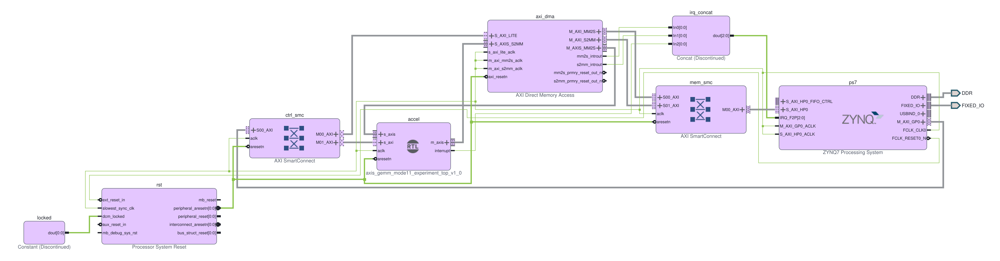

图4　Vivado原生Block Design。PS通过GP0和ctrl_smc访问DMA及加速器控制寄存器；DMA的MM2S/S2MM流接口连接加速器，存储器主接口经mem_smc访问PS的HP0。FCLK及Processor System Reset提供时钟/复位，中断经irq_concat汇入PS。原生SVG/PDF随本版保留。[E01、E41]

### 2.2.4 RTL流水与接口验证

图5将8×8阵列的输入、乘积和累加放在同一时间轴上。固定用例采用M=N=8、K=1，两块激活分别为1和2、权重行为1至8，输出行分别为1至8和2至16。PE(0,0)在1005 ns接收输入，随后两拍产生乘积和累加；PE(7,7)更晚响应，直观呈现阵列传播与流水关系。[E41]

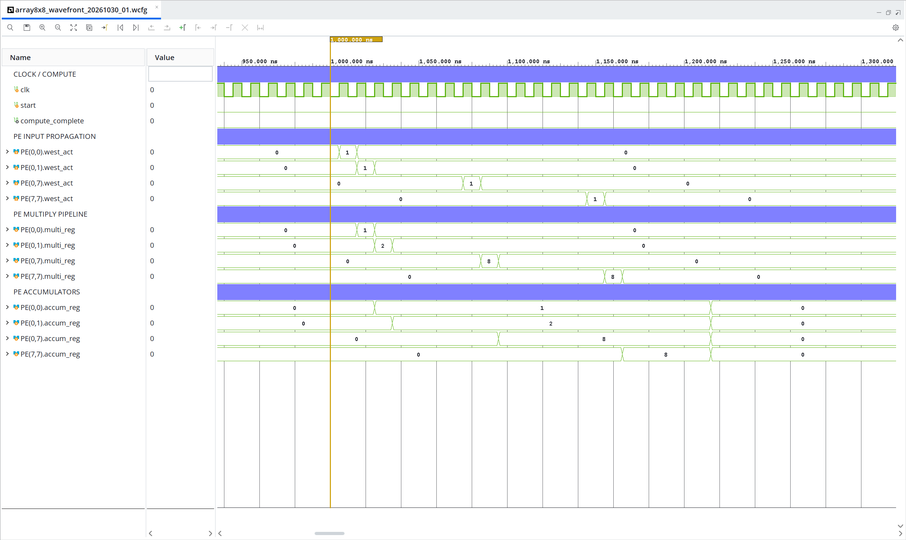

图5　8×8阵列的Vivado原生仿真波形。固定测试台以M=N=8、K=1驱动真实计算核心；图示首块中，激活沿阵列传播，乘积与累加随后更新。PE(0,0)的输入、乘积和累加分别在1005、1015和1025 ns出现，PE(7,7)对应时刻为1145、1155和1165 ns。时钟周期10 ns。[E41]

图6显示bank1计算写入与bank0结果读回同时进行，重叠计数从0增长到16；图7放大输出握手，显示背压期间的数据保持和有效握手后的计数推进。用例共核对2块任务、64个输出拍及局部复位行为，fail=0。[E41]

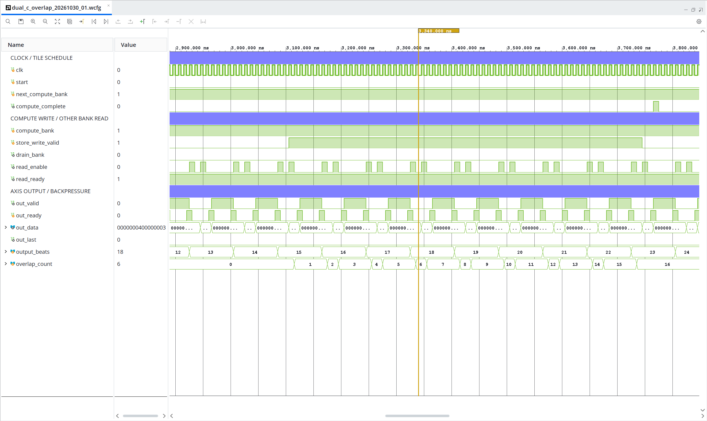

图6　双C-bank计算写入与结果读回的原生波形。约3105–3735 ns期间，计算结果写入bank1，bank0的读回仍在进行；计数器记录16次不同银行的PE写入与有效读回重叠事件。两块用例共输出64个64-bit拍，2次计算完成，fail=0。[E41]

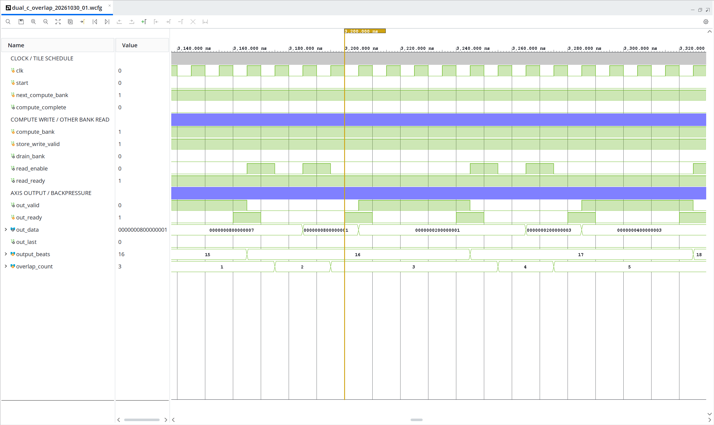

图7　AXI-Stream输出背压局部。约3210–3240 ns内out_valid=1、out_ready=0，out_data保持0000000200000001；有效时钟沿握手后output_beats才推进。图中read_enable/read_ready属于C-bank读接口，out_valid/out_ready属于输出接口，两组握手分别解释。[E41]

本轮固定测试台重放中，PE单元30项、AXI包保护21项检查通过。历史MODE11随机回归另保留31组情形与31,002次元素配对，MMIO回归读到D075构建身份，独立重定量化流水保留1,016项检查。各用例的原始日志和本轮波形来源分别记录。[E41]

### 2.3 软件系统介绍

#### 2.3.1 软件整体介绍

软件分为通用矩阵、KWS应用和复现工具三层。通用矩阵路径生成分块与任务链，共享资源管理对象持有Overlay及根缓冲，调用对象通过驱动提交。KWS把Pointwise转成GEMM，ARM执行逐通道校正与Depthwise；完整离线图继续连接WAV特征、CPU前后缀和分类。工具层对源码、BIT/HWH、输入名单及原件建立尺寸和SHA索引，以固定版本复跑。

[[FIGURE:fig08_kws_graph]]

DS-CNN采用Depthwise与Pointwise交替结构[8]。Op2与Op4同为125×64×64，但权重、张量和前驱不同。真实共享中段按tensor23→Op2→tensor24→DW3→tensor25→Op4→tensor26执行。DW3把动态Op2输出变形为1×25×5×64的NHWC数组，以输入零点−128完成3×3 SAME填充，逐通道点积并重定量化，再生成独立拥有内存且C连续的新矩阵供Op4使用。

完整PC图从公共WAV生成49×10个INT8特征，CPU执行Op0、Op1形成tensor23，共享接口执行中段后，由CPU运行Op5..11得到12个Softmax前分类值（pre-softmax logits）。该图的PL资源由WireEnvironment夹具模拟：夹具解码实际发送字节后计算返回，黄金张量只用于事后比较。真实共享中段与完整PC图的运行环境分别记录，图8对应两者的数据依赖。

#### 2.3.2 软件各模块介绍

矩阵主机先检查数据类型、形状和配置，再按M/N/K生成块及首子任务编号。请求内重复使用的面板先构造一次，flat路径直接写入平坦帧；连续面板路径使用ascontiguousarray(view).tobytes()物化C序视图[6]，发送字节与原路径保持一致。满面板至多新增4,096 B连续临时数组，这一数值描述单面板临时分配，不代表进程峰值驻留内存（RSS）。

驱动调用链从SharedCall进入SharedOwner.execute_chain，经FlatPackPynqGemm.run_chain调用PynqGemm._submit_chain。一个SharedDeviceSession只初始化一次Overlay、分配两块根缓冲并在正常结束后关闭一次；24次交替请求使用一次性JobPermit，对应连续子任务编号 1..48。PYNQ的物理连续内存和缓存同步按其分配接口管理[5]。资源管理对象遇到返回前异常时保留未决资源，父进程通过实际等待退出和进程组查询记录退出，避免在硬件状态未明时释放缓冲。

InputEnvelope绑定算子、张量、窗口、来源及完整值，在构造和提交前拒绝错层、跨窗或不独立拥有内存的输入。返回后先核8,000个原始点积INT32，再执行输入零点校正、偏置及逐通道定点重定量化，最后核INT8。量化使用冻结模型的尺度与零点，逐通道权重规则参照LiteRT规格[7]。此顺序可以识别被ReLU截断为−128的单比特错误；传输帧逆解码则确认下游实际收到当前DW3输出。

函数流程按调用层级和实际数据依赖展开。完整PC候选由run_hybrid_candidate.py核对输入后调用run_hybrid_session；HybridGraphExecutor.run_prefix接收Frontend.process现算的49×10 INT8特征，执行Op0、Op1，输出独立拥有内存的125×64 tensor23。共享中段返回tensor26后，run_suffix继续执行Op5至Op11，生成12个INT8分类值tensor33。

SharedCall接收绑定窗口和张量身份的InputEnvelope，经SharedOwner.execute_chain、FlatPackPynqGemm.run_chain进入PynqGemm._submit_chain。每个Pointwise请求的有效输入帧为16,512 B，返回32,000 B原始INT32；返回后核对8,000个值，再完成偏置、零点校正和INT8重定量化。DW3接收Op2的动态输出tensor24，生成tensor25供Op4使用。上述函数流中，完整PC图使用WireEnvironment；已完成的真实ARM/PL共享中段采用同一驱动调用层级，现场输入及执行范围见KWS验证章节。[E21、E30–E34]

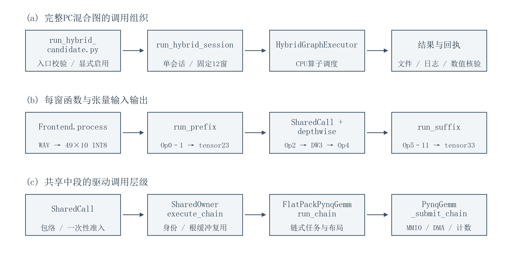

补图1　上两行描述完整PC混合图，第三行展开共享中段调用。图中输入输出由实际候选源码核对；完整PC图与真实共享中段的运行环境分别记述。

报告修订使用scientific-writing组织来源与章节核对，配合anti-defensive-writing和lieflat-less-ai-tone检查叙述；技术交互按来源核对，新增说明另行审校。相关程序化写作工作流参考Scientific Agent Skills[9]，这些工具用于文稿与来源整理。

#### 2.3.3 团队主导的实现与验证Skill

团队将设计目标落实到函数调用、数组布局与测试出口，通过实现指导、代码审查和调试参与驱动及脚本迭代，编程模型辅助完成候选代码和反例。参考绑定任务明确覆盖derive、调用对象构造、make_jobs及执行入口四处sources()调用，并将冷绑定参考与受限错误阶段纳入修订。跨层接线由团队确定Op2→DW3→Op4路线，把前层实际返回值、NHWC变形和实际传输帧核验写入实现要求。[E27、E40]

[[FIGURE:fig09_team_workflow]]

协作案例以技术任务和实现修订呈现。参考绑定任务由团队给出函数范围和执行顺序，模型辅助完成绑定模块与顺序回归；DMA身份检查的初步方案依赖实例名，团队结合伪DMA反例复核实现，修订为精确MODTYPE/VLNV声明检查，并补充HWH-only与CLI回归。阶段计时分析则经团队复核起止点，移除transfer/wait的重复归因。任务要求、候选方案、审查修订及验证结果构成连续的工程协作记录。[E27、E40]

pynq-dma-validation先核BIT/HWH和精确IP声明，再检查DMA几何；pynq-gemm-validation先核布局和原始点积，再核量化结果；engineering-evidence-review从计时起止与样本定位结论。检查器在Linux通过90个方法且0跳过，复现成员在另一电脑以AI辅助使用Skill处理十个既有合成案例，按事前40项标准评阅为40/40。前者验证程序行为，后者检验既定案例中的使用过程。图9呈现团队设计、实现评审、异机构建与现场验证之间的反馈。

团队把审查问题写成具体实现任务。附录中的完整输出接线和四处参考调用清单，展示了要求如何进入代码；模型首轮引用错误及ticket采集次序的修正，则保留了实现自检与补测过程。原文和修订结果见文末技术交互附录及[E43](evidence/e43.md)。

#### 2.3.4 分层复现入口

工程以opennpu_lite_41971组织src、sim、build、board、data、skill、report及provenance。顶层manifest索引文件数量以本交付manifest为准，外部SHA256固定为下值。取得完整目录后先核身份，结果写到包外新目录；文档随附《复现操作指南》，列出环境安装、完整命令、预期输出及错误处置。

```text
<外部checksums.txt中的manifest_sha256>
```

PC已测环境为Windows x86-64、Python3.12.14、NumPy2.3.5。先用可信Python创建独立venv并安装numpy==2.3.5；在PowerShell填写实际路径后执行以下入口。每一行命令退出非零即停止，保留标准输出、标准错误及运行回执；输出目录本身必须不存在。

```powershell
$basePy = 'C:\Python312\python.exe' # 实际可信Python3.12路径
$root = 'D:\OpenNPULite\opennpu_lite_41971' # 完整工程已解压
$envDir = 'D:\OpenNPULite\python_env_01'
$runs = 'D:\OpenNPULite\runs'
function Invoke-Checked([string]$Exe,[string[]]$ArgList) {
  & $Exe @ArgList
  if ($LASTEXITCODE -ne 0) { throw '命令失败，停止并保留输出。' }
}
if (Test-Path -LiteralPath $envDir) { throw '环境已存在，另选新目录。' }
Invoke-Checked $basePy @('-m','venv',$envDir)
$py = Join-Path $envDir 'Scripts\python.exe'
Invoke-Checked $py @('-m','pip','install','numpy==2.3.5')
if (-not (Test-Path -LiteralPath $runs)) {
  New-Item -ItemType Directory -Path $runs | Out-Null
}
$pin = '<外部checksums.txt中的manifest_sha256>'
Invoke-Checked $py @('-I','-B',"$root\reproduce.py",'--manifest-sha',$pin)
Invoke-Checked $py @('-I','-B',"$root\reproduce.py",'--manifest-sha',$pin,
  '--profile','pc','--enable-offline','--output',"$runs\pc_01")
Invoke-Checked $py @('-I','-B',"$root\reproduce.py",'--manifest-sha',$pin,
  '--profile','hybrid-smoke','--enable-offline','--output',"$runs\smoke_01")
Invoke-Checked $py @('-I','-B',"$root\reproduce.py",'--manifest-sha',$pin,
  '--profile','hybrid12','--enable-offline','--output',"$runs\hybrid12_01")
```

默认文件核验（check）应返回files与交付清单一致且不执行推理。PC回执核实际子进程退出0、运行后文件不变标记immutable_export_verified_after=true；Windows旧入口5项平台跳过单列。混合图核窗口名单、全值差异及历史VAD标记。原候选12窗独审与导出一窗验证分别留存，运行者用自己的新输出确认结果。

仿真将sim/d075复制到独立可写目录，按sim/run_regression.ps1指定VivadoRoot执行xvlog、xelab和xsim。完整构建采用Windows Vivado2026.1、Zynq-7000器件/IP支持与PYNQ-Z2板定义，依次运行src/hardware/verify_kit.py、rebuild.py check、prepare、build；板定义SHA、工具参数及命令见随附指南。成功需取得资源、自然setup/hold报告和BIT/HWH/XSA，不能只检查进程退出。成员已完成同配置CMD路径的异机完整构建；新v3包装本身的真实冷构建尚待接收者验证。

板端复做从board/quickstart.md取得当前运行包和完整步骤，先核原件、时钟、供电及真实环境，再生成新的预检记录和运行计划；操作者确认后单次运行，依次只读回读、归档及两端SHA核对。历史启动标识、锁索引和运行计划用于回读，不复制成新现场值。公开仓库地址和第三方资产再分发许可在发布前另行核定；本次文档制作不启动仿真、构建或板测。

## 2.4 设计取舍与验证依据

设计取舍同时考察正确性、映射资源与完整请求。早期C-store流水写回方案通过15个测试台的4,196项检查，OOC时序也满足100 MHz，但Vivado把4096×32存储映射为1,408个RAM64M，而非预期的4个RAMB36E1。团队因此撤回该方案，恢复明确的BRAM基线，并将端口行为和银行所有权纳入后续设计。这一过程说明，仿真、综合和集成实测分别揭示不同工程约束。[E26]

硬件稳定后，团队用请求分解选择下一优化对象；接口修订先形成可执行反例，再由完整调用与返回原件核对。共享KWS将已验证矩阵接口连接到动态张量，Skill将身份、算术和测量规则提炼为可复用步骤。复现按2.3.4的环境、输入身份、软件、仿真、构建和板端层次推进，每层检查实际输出并保留失败。

## 第三部分　完成情况及性能参数

### 3.1 整体介绍

系统已形成PYNQ-Z2硬件、ARM运行软件、PC复现工具与UT70采集分析的完整实验平台。矩阵任务验证计算通路，KWS验证模型张量跨PS/PL传递，原始回读、清单与独立参考连接软件输出和真实设备行为。

实物图1–2展示系统连接、开发板俯视与斜视，供电与通信路径可与2.2节的接口说明对照。

#### 实物平台与连接

实物平台由主机、PYNQ-Z2开发板与USB测试仪组成。以太网承担板端通信，单路USB路径提供供电；俯视和斜视照片展示主要接口、散热器及指示灯。

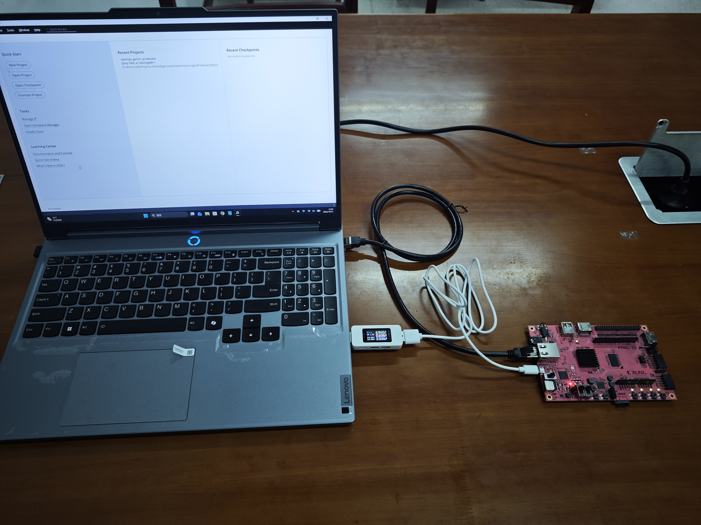

实物图1　系统全貌。主机经以太网连接PYNQ-Z2，USB供电路径串接UT70测试仪。

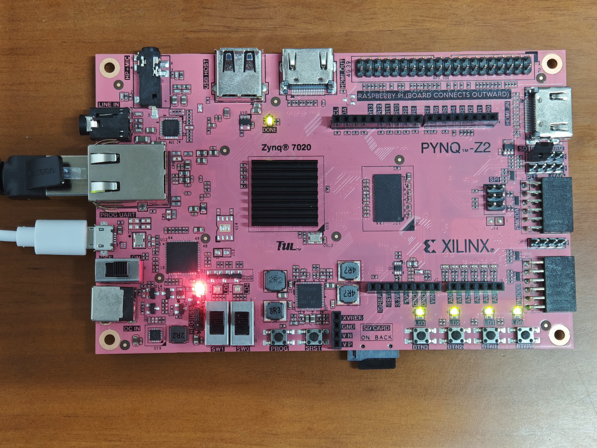

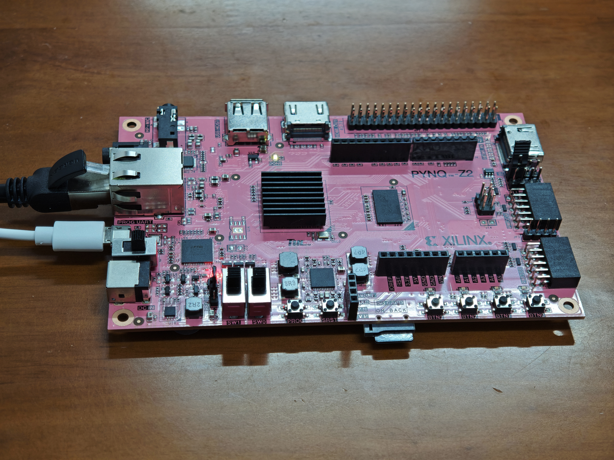

实物图2　开发板实物。（a）俯视；（b）斜视。网口与Micro-USB接口位于板卡左侧，独立DC输入未连接。

## 3.2 工程成果

#### 3.2.1 机械成果

采用商用开发板，无独立机械结构件。全貌照片承担实物组合展示，避免以结构示意代替实际装置。

#### 3.2.2 电路成果

D075完成综合、布局布线、BIT/HWH生成与实板运行，主实验BIT和HWH绑定同一工程。交付保留RTL、约束、完整实现报告及原始运行归档。实物图2的开发板近照对应2.2节的实物接口；自研逻辑关系由图1–3及源码说明。

最终硬件以源码与生成物身份固定。D075在十月继续用于矩阵和共享KWS中段；10月13日干净重建核对47份输入，资源与自然时序报告正文一致，4,045,564 B配置载荷逐字节相同。构建成员在另一电脑完成同配置CMD/BAT完整构建，并补齐来源端ZIP哈希。[E01、E18、E19、E21]

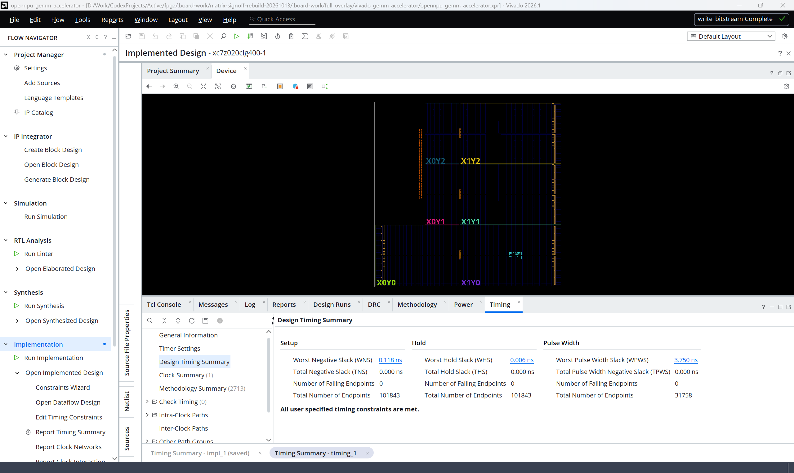

图10　同一D075路由检查点的原生时序窗口。此视图保留实现阶段额外0.060 ns最小延迟要求，WNS=+0.118 ns、WHS=+0.006 ns，TNS/THS均为0；恢复原0 ns要求后的自然约束签核报告为WHS=+0.066 ns。两份原报告分别保留。[E01、E41]

图10为额外0.060 ns最小延迟要求下的实现视图，WHS为+0.006 ns；表中自然约束签核值为+0.066 ns，两者按约束分别解释。厂商DDR preset相关告警、DMA RAM Advisory及152条TIMING-46逐路径核查随工程保留。[E01、E41]

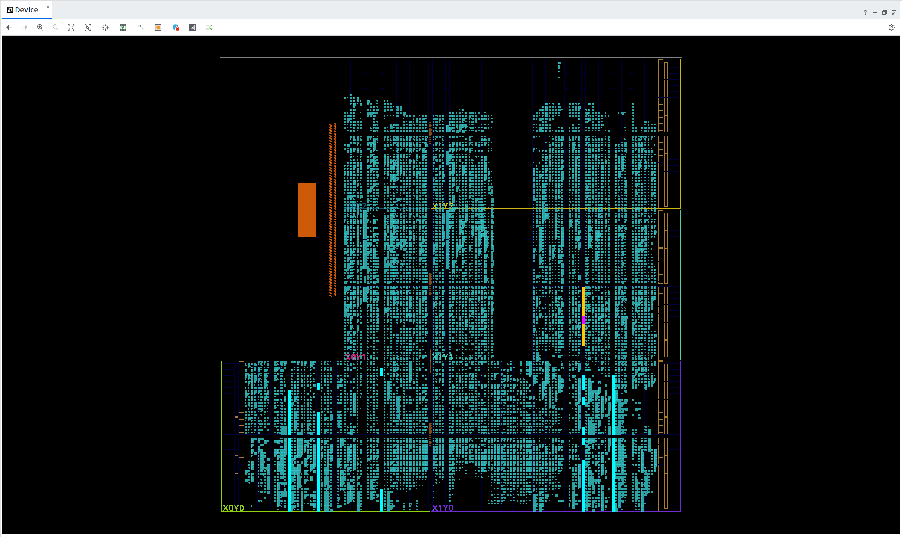

图11　D075已实现设计的Device资源分布。按已放置网表逐项核对，64个PE乘法DSP以青色高亮，7个量化DSP为橙色，1个工作量计数DSP为紫红色，72个物理DSP站点互不重复。背景中的青色已放置逻辑同时包含LUT/FF等资源，DSP用途以对象与站点清单判定。[E01、E41]

图11结合物理站点清单说明72个DSP的用途分配。随附PE原理图则从实际数据连接选取单PE乘法器的实现局部，保留SVG/PDF供放大查阅。[E41]

#### 3.2.3 软件成果

软件交付包括矩阵主机、共享KWS候选、整数参考、清单核验、只读回读与复现入口。运行图1–3展示矩阵与共享中段的实际完成状态和结果汇总，实物图3补充同次演示的系统斜视画面。完整工程及报告的来源表记录各资产的版本、大小和SHA。[E42]


### 现场运行与完成状态

2026年10月31日，平台在同一次开机中顺序完成矩阵对照与共享KWS中段演示。矩阵部分执行72次调用，其中24次预热、48次正式；共享中段执行12窗、24次Pointwise请求和48个job。两段启动器均以0退出，并保存正常清理记录。运行图1–3取自此次原始录屏。[E42]

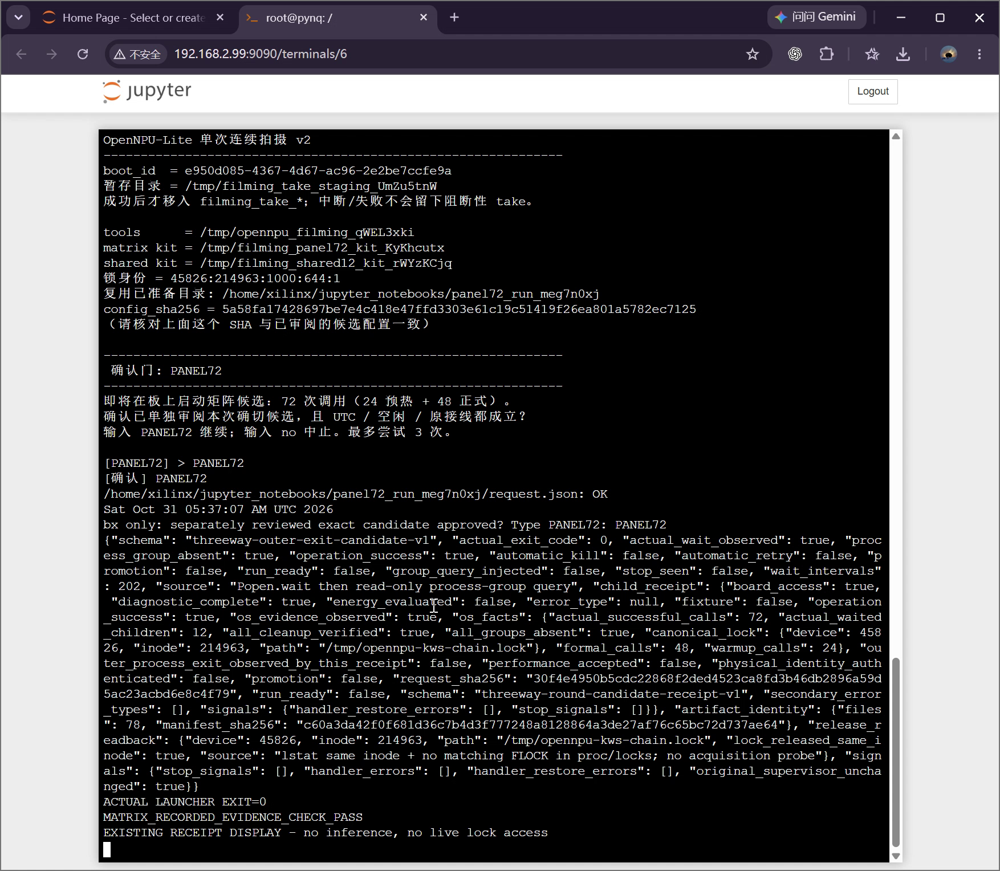

运行图1　矩阵测试完成画面（原始录屏04:15，局部）。回执记录72次成功调用、48次正式调用及资源清理通过，末尾显示启动器退出码0和记录核验通过。

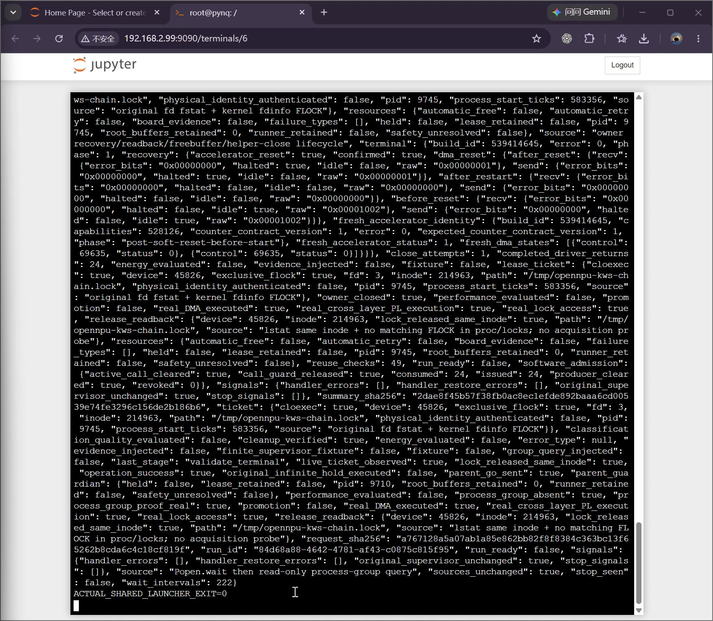

运行图2　共享中段完成画面（原始录屏09:39，局部）。终态记录真实DMA、真实跨层PL执行、同inode锁释放及清理通过，启动器退出码为0。

### 复现结果与现场装置

本次矩阵完整请求均值在256³下由57.601 ms降至51.742 ms，在512³下由261.115 ms降至238.188 ms，分别缩短10.17%和8.78%；同场双线程OpenBLAS均值为25.073 ms和166.295 ms。该组独立复现与10月22日结果方向一致，按当日场次单列。[E42]

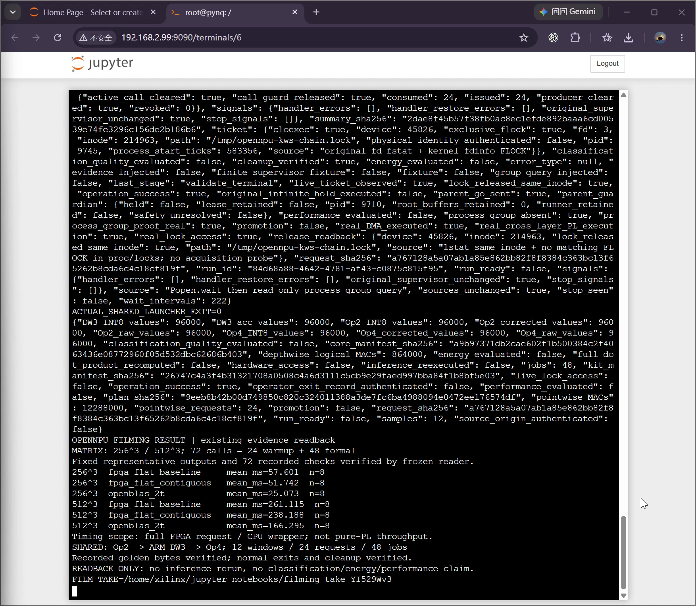

运行图3　完成后的只读结果汇总（原始录屏10:10，局部）。六组计时各含8次正式调用，末段汇总12窗／24请求／48个job；计时范围为完整FPGA请求或CPU包装入口。

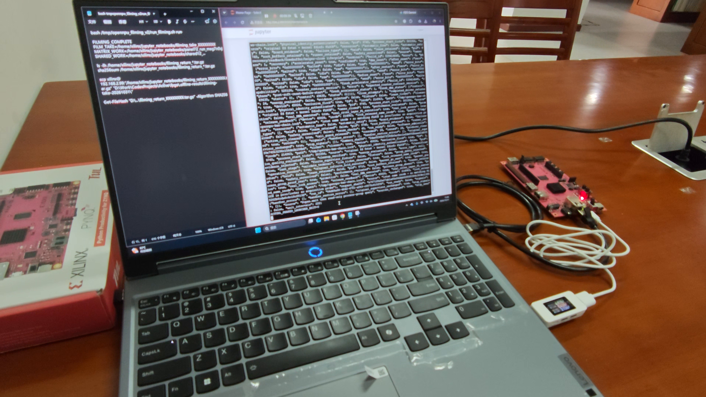

实物图3　连续演示现场的系统斜视画面。主机、PYNQ-Z2、UT70及USB供电和以太网通信连接同时入镜，取自手机原始录像09:28。

共享中段逐字节核对Op2的raw／校正／INT8、DW3的累加器／INT8、Op4的raw／校正／INT8，共八类768,000个检查点。此次记录用于复现数值返回、请求排程与正常退出；分类质量和能量结论沿用对应独立实验。录屏时间点和原件SHA见E42。

### 3.3 特性成果

#### 3.3.1 资源、时序与硬件执行

表3比较D007-P和D075两套完整集成实现。D075新增结果存储及相关控制，代价为2,473 LUT、2,525 FF及4 BRAM Tile；DSP数量保持72，其中64个用于PE、7个用于量化、1个用于计数。该表描述集成版本之差，各机制的独立贡献由对应实验解释。[E01、E35–E37]

| 资源 | D007-P | D075 | XC7Z020容量 |
| --- | --- | --- | --- |
| LUT | 24,289 | 26,762 | 53,200 |
| FF | 25,050 | 27,575 | 106,400 |
| BRAM Tile | 7 | 11 | 140 |
| DSP | 72 | 72 | 220 |

[[FIGURE:fig04_resources]]

100 MHz完整实现的setup余量+0.118 ns、TNS=0，hold余量+0.066 ns、THS=0。512³纯PL时间30.044830 ms，按134,217,728 MAC计得4.467249 GMAC/s；同类DMA+PL窗口为4.293349 GMAC/s。64个PE在100 MHz下理论峰值6.4 GMAC/s，有效吞吐达到理论峰值的69.80%，这一比值按整个纯PL窗口计算。

同一BIT内比较MODE10与MODE11的20对512³任务，DMA+PL从36.221124 ms降至31.261776 ms，约1.159倍。预取和双C-bank分别面向输入等待与输出阻塞，计数守恒检查与墙钟结果共同验证调度作用。[E01、E05]

资源利用与数据复用需要联合评价。当前11 BRAM Tile占器件7.86%；512³任务按输出子任务重复发送面板，输入载荷为4,194,304 B，相对原始A、B合计524,288 B为8倍。一次请求中64个A面板和64个B面板各自独立打包，传输帧内共出现1,024次面板。原始输入、原始输入加INT32输出、实际传输帧输入加输出三个边界对应算术强度约256.0、85.33及25.58 MAC/B。跨子任务操作数驻留是后续明确优化对象，当前结果反映既有协议下的调度与主机改进。[E35、E37]

#### 3.3.2 主机优化与完整请求

两轮实验固定D075硬件，分别比较旧构帧与flat、flat与连续面板。每场共72次调用，24次预热、48次正式，按尺寸与后端分组后每条件8个正式样本，使用两组固定输入和交替执行顺序。CPU对照均为同场双线程OpenBLAS。表4给出完整请求均值，百分比只在同行基线与候选之间计算。[E07–E11、E38、E39]

| 场次/尺寸 | FPGA基线 ms | FPGA候选 ms | 同场CPU ms | 请求变化 |
| --- | --- | --- | --- | --- |
| 10/21　256³ | 57.296 | 57.693 | 25.163 | +0.69% |
| 10/21　512³ | 272.113 | 242.822 | 172.241 | −10.76% |
| 10/22　256³ | 58.733 | 52.672 | 25.342 | −10.32% |
| 10/22　512³ | 266.977 | 241.510 | 171.555 | −9.54% |

[[FIGURE:fig05_complete_request]]

10/22的512³事务构造从95.454 ms减至71.131 ms，而内部DMA+PL为30.849/30.966 ms，表明本轮收益主要来自主机组织。图14将完整请求拆为互斥外层阶段及残差，内部DMA+PL作为受控提交的细节，不重复相加。两轮512³分别改善10.76%和9.54%，对应不同日期和基线；完整FPGA请求仍长于各自同场CPU。

[[FIGURE:fig06_request_stages]]

优化采用依据是全请求实测。native_prepared候选曾在实板退化47.07%，团队保留失败并停止后续长测，将工作集中到已定位的构造成本。该过程说明，减少高层调用或转向原生代码需要结合实际数据组织验证。[E08]

#### 3.3.3 同工作量能量观察

能量实验采用一组CPU—FPGA—FPGA—CPU的ABBA次序，每窗452次正式调用，预热在保存前完成。UT70上位机以10SPS保存完整包络，按Wh端点和同源功率积分分别核算。CPU两窗能量均值262.6938 J、FPGA两窗258.9786 J，端点差−3.7152 J（−1.4143%）；功率积分差−1.3989%。两种核算基于同一次采样，图15保留四窗原值及差额。[E12、E13]

[[FIGURE:fig07_energy_abba]]

完整保存包络包含相应服务过程，未扣空闲，也不折算单次推理能量。同场请求均值CPU为170.5267 ms、FPGA为220.4783 ms；进程CPU时间从331.8055 ms降至195.3539 ms。此次结果呈现了延迟、处理器占用与供电能量的不同变化方向。稳定节能评价还需重复配对和独立单位/精度核定，尤其需确认CSV原始mV/mA标头与按V/A解释的换算关系。

#### 3.3.4 KWS应用接入与动态等价

ARM CPU420从公共WAV重新计算前处理和完整CPU整数链，205,800个特征值及5,040个分类值与PC参考逐字节一致。新DS-CNN分类正确383/420（91.19%），旧模型为350/420；改善主要来自unknown，目标口令正确数为268/300，对照旧模型270/300。按冻结门控，新模型正确目标放行214/300，负例误动作0/120、错误目标口令放行1条。固定集分类和动作门控分别评价，当前门限保持原值。[E14、E16]

真实共享中段在一次SharedOwner会话中执行12次Op2、12次ARM DW3及12次Op4，共48个连续子任务。Pointwise工作量12,288,000 MAC，DW3含空间填充逻辑工作量864,000 MAC。Op2与Op4各核原始点积、校正、INT8三类，DW3核累加器与INT8两类，每类96,000值，合计768,000个检查点零差异；264份二进制对应冻结参考。24条运行MMIO记录满足MODE11版本2、65535哨兵与工作守恒，父进程等待退出、进程组消失、一次关闭及同一锁文件索引释放闭合。[E21、E22]

完整PC图固定12窗进一步完成5,880个动态特征和144个动态分类值对齐。纯标准库逐层复算865,680个算子输出，737份二进制跨平台逐字节一致；17项单测0跳过、5项CLI负例按预期拒绝。动态结果放行8个正确命令，两个已有错分类因低分拒绝，unknown与silence被非命令规则拒绝。评分采用Op11真实输出，VAD使用绑定本窗PCM的历史标记。[E30–E34]

| 验证层次 | 实际环境与输入 | 完成内容 |
| --- | --- | --- |
| CPU420 | ARM；公共WAV | 前处理与完整CPU整数参考 |
| 共享12窗中段 | 真实ARM/PL；冻结CPU前缀tensor23 | 动态Op2→DW3→Op4及正常清理 |
| 完整图12窗 | PC；公共WAV与PL软件夹具 | 前端、前后缀、共享接口及分类 |

#### 3.3.5 验证范围与后续条件

当前矩阵优化解决了已测任务的主机开销，进一步降低外存流量需调整跨子任务驻留与调度。KWS端侧参考平均每窗前处理2,031.107 ms、模型1,160.126 ms，两段合计3,191.233 ms/一秒音频，尚不满足实时输入；完整混合模型实板与420窗混跑质量是后续独立验收对象。完整PC图保留前置清单常量和测试用VAD替代参数的两项非阻塞观察，固定运行入口不开放该替代参数。历史MODE11长稳记录为1,800.008108 s、8,302对运行，对应原硬件和入口；共享12窗验证正常生命周期，性能、恢复与长稳按各版本分别评价。[E05、E29–E34]

## 第四部分　总结

### 4.1 可扩展之处

下一步以已定位成本为导向：为跨子任务的A/B操作数驻留设计地址与调度接口，降低重复传输；在保持线格式和全值核验的条件下优化主机事务组织；将完整KWS图接入真实ARM/PL并评估前端、VAD与目标口令门控。各项改进沿用同场完整请求、固定数据集和独立数值参考，分别评价延迟、质量与能量。现有任务接口、计数器和分层复现工具为这些扩展提供可比较的基线。

### 4.2 心得体会

研发中最重要的转变，是把优化对象从阵列扩展到完整请求。硬件窗口缩短后，事务构造仍占较大比例。团队据此保持已验证硬件，细化主机数据布局和调用路径，以同场实验决定采用。实测让设计取舍有了共同尺度。

原生主机路径是一次关键取舍。它在14次功能冒烟中完成737,224个INT32位置精确核验，但七种形状的首次完整调用均变慢，512³从283.486 ms增至416.921 ms。团队核对返回、计数与源码后，发现新路径仍包含原驱动工作，并增加输入摘要、帧快照和操作数比较。局部构帧收益没有覆盖整条请求的成本，团队因而停止正式长测，保留功能成果与负结果，将后续优化转向面板组织。[E08]

CPU对照也影响优化判断。团队引入同场双线程OpenBLAS，以固定输入、预热和交替次序比较完整请求，再用互斥阶段分解定位改进。纯PL吞吐、DMA与主机耗时分别回答不同问题，最后由请求级数据决定方案取舍。这个过程使优化围绕可定位的成本展开。[E07、E38、E39]

团队对实现的参与贯穿接口设计、函数级指导、代码审查和测试修订。负责人将参考绑定细化为四处sources()调用与错误出口，将跨层组合落实为动态张量、NHWC变形及实际发送帧检查。构建成员在另一电脑编排CMD/BAT构建入口，完成完整构建与来源哈希核对；复现成员使用Skill回核案例。负责人组织接线、计划核对与主要板测，10/26共享链采用授权的浏览器辅助执行并保留人工确认。模型辅助代码、脚本和反例，团队据运行反馈作出修订与采用判断。

几次失败直接改善了方法。伪DMA实例迫使检查器从名字判断转向精确声明；量化掩盖的单比特反例使原始点积检查前移；计时重复归因促成互斥外层分解。团队将这些经验写成Skill，通过程序回归和异机使用确认规则的作用范围。项目由此交付了可编程矩阵通路、真实PS/PL应用中段和完整离线计算图，也形成了从问题、编码修订到实测取舍的协同研发过程。

## 第五部分　参考文献

[1] GENC H, et al. Gemmini: Enabling Systematic Deep-Learning Architecture Evaluation via Full-Stack Integration[C]. DAC, 2021. https://arxiv.org/abs/1911.09925v3 . 工程：https://github.com/ucb-bar/gemmini .

[2] CHEN Y H, KRISHNA T, EMER J, SZE V. Eyeriss: An Energy-Efficient Reconfigurable Accelerator for Deep Convolutional Neural Networks[C]. ISSCC, 2016: 262–263. https://www.mit.edu/~sze/eyeriss.html .

[3] NVIDIA. NVDLA Hardware Architectural Specification, v1[EB/OL]. https://nvdla.org/hw/v1/hwarch.html .

[4] AMD. AXI DMA PG021: Direct Register Mode (Simple DMA)[EB/OL]. https://docs.amd.com/r/en-US/pg021_axi_dma/Direct-Register-Mode-Simple-DMA .

[5] PYNQ. Allocate[EB/OL]. https://pynq.readthedocs.io/en/latest/pynq_libraries/allocate.html .

[6] NumPy. ndarray.tobytes; ascontiguousarray[EB/OL]. https://numpy.org/doc/1.25/reference/generated/numpy.ndarray.tobytes.html ; https://numpy.org/doc/stable/reference/generated/numpy.ascontiguousarray.html .

[7] Google. LiteRT 8-bit quantization specification[EB/OL]. https://developers.google.com/edge/litert/conversion/tensorflow/quantization/quantization_spec .

[8] ZHANG Y, SUDA N, LAI L, CHANDRA V. Hello Edge: Keyword Spotting on Microcontrollers[EB/OL]. arXiv:1711.07128, 2017, v3修订于2018-02-14. https://arxiv.org/abs/1711.07128v3 .

[9] KASSIS T, AGARWAL V, HE Y, et al. Scientific Agent Skills: A Library of Procedural Knowledge for Research Agents[EB/OL]. arXiv:2609.00065v2, 2026. https://doi.org/10.48550/arXiv.2609.00065 .

上述技术文档及相关工作核查日期为2026-10-27。E编号对应工程报告来源索引；随附来源对照表记录本系统版各节复用的原件与SHA，复现命令详见随附《复现操作指南》。


[E42 10月31日连续演示原件与软件运行画面](evidence/e42.md)

# 附录　团队主导的人机协作记录

团队从源码核查和测试结果中选择问题，提出接口级要求，并据此组织实现与验收。以下三例依据实际交互整理，对措辞和重复内容作编辑性归并；后续发现按实际先后记录。原始节选及索引单独保留，便于核对。

## C01　先弄清计时边界，再决定改哪里（2026-10-20）

负责人汇总源码核查与审查意见，把优化问题落实到事务构造、构帧和记录重建。模型随后收紧差额的解释，避免把嵌套计时差额全部归到一个函数。

**团队提示词**

先检查事务构造、pack_chain和记录重建，找出每次请求里重复创建对象、遍历内容或拷贝数据的位置。对照源码核准各段计时的起止点，再提出保持计算和验证语义不变的小改动。旧驱动保留，新方案和旧方案、当场OpenBLAS双线程按同一完整请求口径比较。

**模型对归因边界的修正**

> 约 88.7 ms 是两个嵌套计时窗口之间的差额

**模型安排的实现步骤**

> 先读相关调用链，再提出最小改动，不直接重写驱动。

团队据此以互斥外层阶段和嵌套窗口组织诊断。10/21的flat构帧与10/22的连续面板分别进行同场验证，实测结果见性能章节；不将两个场次连乘。来源：E17、E27、E38、E39。

## C02　把首错保留落实到函数参数（2026-10-21）

负责人采纳并提交代码级接线意见，要求把完整输出连同摘要交给协调器。该指令明确了下一次请求能否启动的判断位置，也让反例能够检查失败数据是否真正留存。

**团队提示词**

输出返回后，先计算digest = hashlib.sha256(output.astype('<i4', copy=False).tobytes()).hexdigest()，把(spec, result, digest, output)一起交给RoundCoordinator.accept，让内部verify_output核对完整输出。要让RetainedOutputs在纯数值不匹配时也能留下首份.bin，核对完成后再允许下一次请求。旧、新后端沿用runner_type切换，硬件计数器和安全检查保持原样。

**模型的答复与判定修正**

> 我会按前两点推进第四阶段的离线接线，保持旧驱动、安全门禁和冻结包不变。第三点会拆成两层判定：正确性、退出与清理是硬门；性能按同场实测单独报告。“同量级”或优于历史负结果不能预先算性能通过，拷贝量也不直接换算成收益。

**模型对全量核对顺序的落实**

> 已确认三后端比较层已有旧／新 `runner_type` 选择逻辑，我会沿用它。接下来补 FPGA 块执行器的逐次握手和父进程退出观察，让每次输出先进入统一全量核对，再允许下一次请求；同时验证纯数值错误能留下首错输出。

接线候选完成306项历史离线测试及12个真实PC子进程演练。首错输出、停止与退出观察分别验收；该阶段的硬件、MMIO/DMA和规范锁均为软件夹具。来源：E17、E38；matrix-threeway-runtime-20261021_01。

## C03　四处调用覆盖与两次实现修正（2026-10-24）

实板失败诊断把问题指向参考模块的冷绑定与运行期导入顺序。负责人采用诊断方案，进一步提交四处调用点及受限错误阶段的清单。下面按原时间顺序呈现这一次要求及模型连续反馈，包含首轮测试发现的问题和封包复查后的补测。

**团队提示词**

请把四处sources()调用都查到：worker派生、调用对象构造、make_jobs和执行入口。参考模块在导入pynq之前先校验、绑定，owner启动后使用这份绑定，保留对tensorflow、tflite_runtime及同名异路径模块的检查。原数学、计数、监督和锁合同不变。补齐冷绑定后pynq持续驻留的12窗完整顺序测试；报错时写清发生阶段，诊断只留有界ASCII摘要，不含环境变量、凭据或未受限栈帧。

**11:07 UTC　模型确认实现范围**

> 我会按已批准范围实现新版本，覆盖你列出的四处运行期调用点，并补齐阶段诊断和初始化后的 12 窗顺序测试。原包与失败原件保持不变；完成离线验证后整理交审，不启动板测。

**11:11 UTC　模型完成第一版接线**

> 实现已把运行时参考函数放入独立命名空间，原离线函数及其禁止 `pynq` 的保护保持不变。运行时只有在核对已初始化 owner 与其持有的 PYNQ 模块对象一致后才允许调用参考函数。接下来验证四处调用点，并检查原函数的代码和全局绑定没有被改写。

**11:15 UTC　首轮测试发现引用问题并修正**

> 新增的 20 项测试已全部通过，包括持续保留模拟 `pynq` 模块时的 12 窗完整调用，以及第 4 窗数值故障、参考构造故障和调用构造故障后的清理检查。首轮测试也暴露并修正了一个模块引用可能间接保留 owner 的问题，失败日志已保留。现在继续跑既有回归；这些仍是电脑上的软件夹具，不算实板通过。

**11:25 UTC　封包复查发现采集顺序问题**

> 完整离线检查已通过，正在复核实际打包的 ZIP。复查资源路径时还发现一个需要补强的细节：owner 初始化成功后，应先保存原锁 ticket，再做新增的参考绑定授权检查，确保授权失败也能留下完整清理证据。我会补上这条反例后再交付；当前不需要你在板端操作。

**11:31 UTC　补充反例与最终回归**

> 补充反例已通过：新增授权检查失败时，仍保留原锁 ticket 和 `closed_owner` 清理证据。最终稿现在共 224 个不同测试方法，正在实际 ZIP 解包后的空目录中做最后复核。交审材料会明确区分原失败、前一作者稿和这份最终稿，避免混用哈希。

第一项修正处理模块引用间接保留owner的问题；第二项把锁ticket采集前移到新增授权检查之前，使授权失败也能留下清理证据。模型依据团队列定的四处路径实现并自检，团队再将候选交独立审查。最终224个不同测试方法通过、0跳过；这组记录属于离线修补，后续实板成绩单列。来源：E40；KWS-pointwise-runtime-binding-20261024_02。

## 团队的判断与实现参与

团队把优化方向拆解到具体函数、参数和测试顺序。完整输出传递的调用示例明确了协调器的验收接口，四处sources()清单限定了运行期接线覆盖；构建成员完成异机构建与来源核对，负责人组织现场验证并决定采用范围。模型据此编写候选、脚本和反例，保留实现错误及补测结果。
